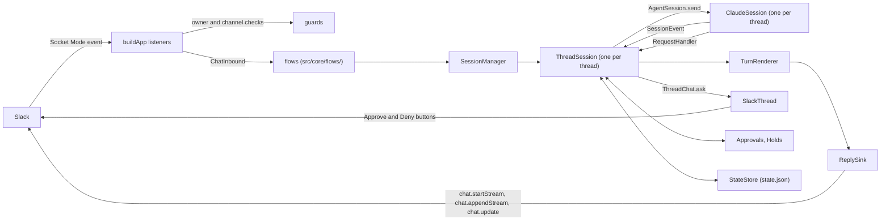

# Architecture

awaydesk is one Node process. It drives one agent from one chat: with the modules that ship, a
Slack Socket Mode connection and one Claude Code process per live thread session, across every
bound channel, all on one event loop. The agent and the chat are modules chosen by name (see
"Modules"); the rest of this page describes the two that ship, `claude` and `slack`.

## Overview

One chat thread is one agent session, which is one `ThreadSession` in the daemon holding one live
`AgentSession`: for Claude, a `ClaudeSession`, a single `query()` of the Claude Agent SDK with
streaming input. A message in a thread goes to that thread's session, and what the session sends
back is written into the same thread. Threads of different channels run side by side on the one
event loop, and each thread keeps the folder it was opened in.

A module is a directory of the source that implements one seam and exports one entry for the
registry. The agent module (`src/agent/claude/`) implements the agent seam; the chat module
(`src/chat/slack/`) implements the chat seam. The source is three layers and a registry, wired by
`main`. Four files sit above them and any layer imports them: `src/clock.ts`, `src/log.ts`,
`src/text.ts` (Python's whitespace and its order of strings, where JavaScript's differ) and
`src/values.ts` (reading a parsed value or a caught error by what it is). `test/imports.test.ts`
reads the imports of every source file and fails on one the table does not allow. The rules are
written by layer, so that they hold for a module that is not there yet: the core imports no
module, a module imports no other module, only `src/main.ts` imports `src/registry.ts` and
nothing imports `src/main.ts`, and a package is imported only by the module that lists it in
`LIBRARIES` (`@anthropic-ai/claude-agent-sdk` for `agent/claude`, `@slack/` for `chat/slack`).
The scan reads a specifier written as a string or a plain template, and fails on an `import()` or
`require()` whose specifier is not a literal and on `createRequire`, which it cannot read.

| Layer | Holds | Imports |
|---|---|---|
| `src/agent/` | the agent seam (`src/agent/seam.ts`) and the Claude back end (`src/agent/claude/`): the SDK's query with its options, hooks and permission callback, the translation of its records into events, folder trust, the session listing, the usage probe | the back end is the only code that imports `@anthropic-ai/claude-agent-sdk`; nothing of the core or of the chat layer |
| `src/core/` | the sessions, the flows (`src/core/flows/`: a message, a word, a request to the owner, a list, the crash repair), the port a provider calls (`src/core/port.ts`), `state.json`, the model of a reply, the pending requests and holds, the daemon's words and texts, the configuration, the lock | the two seams; neither library, and nothing under `src/agent/claude/` or `src/chat/slack/` |
| `src/chat/` | the chat seam (`src/chat/seam.ts`) and the Slack provider (`src/chat/slack/`): the listeners and their guards, the reply sink, the root's reaction and the thread's status line, the Home tab, files, the provider's own texts | the provider is the only code that imports `@slack/bolt` and `@slack/web-api`; the agent seam's types and, of the core, the port alone; never the back end |
| `src/registry.ts` | the agents and the chats the daemon can run, by name | the two modules: the one file outside them that names them |
| `src/main.ts` | the startup order and the shutdown; its first import, `src/require-node.ts`, ends the process with a refusal on a Node older than `node-version.MINIMUM_NODE` | the registry and the core; neither module |

The core talks to the two libraries through the seams alone. No type of the Agent SDK appears in
`src/agent/seam.ts` and no type of a Slack package in `src/chat/seam.ts`. The same holds for
words: `test/vocabulary.test.ts` fails on an identifier or a string outside the module directories
(`src/agent/<name>/`, `src/chat/<name>/`, read from the disk) and `src/registry.ts` that names an
agent, a chat or what only one of them has: the name of each module directory, and `anthropic`,
`bolt`, `threadTs`, `mrkdwn`, `modal`, `ephemeral`, `emoji` (comments are exempt). A text of the core that names the agent or the chat takes the name from the
module (`texts.Named`, `texts.named`, `texts.namesOf`); the Slack provider's own words are in
`src/chat/slack/texts.ts`.

What crosses the agent seam:

| Crossing | Direction | What |
|---|---|---|
| commands | core to back end | on `AgentBackend`: `start`, `listSessions`, `datedSessions`, `aliveSessions`, `folderTrusted`, `trustedRepository`, `usageLimits` and `close`. On the `AgentSession` a start returns: `send`, `interrupt`, `stopTask`, `setPermissionMode`, `setModel`, `setEffort`, `contextUsage`, `info`, `close` |
| events | back end to core | `SessionEvent`, read in order from `AgentSession.events`: the session's id and version, a message's start and end, text as pieces or whole, a call's start and end, a task's life, a compaction, a change of permission mode, effort or folder, a prompt the agent took, word that the coming turn reports a background task (`report_started`), usage limits gone stale, a turn's end, an error message of the agent's, a lost process. A turn has no start event, and `turn_ended` is an event like the others, never the answer to `send` |
| requests | back end to core, which answers | `RequestHandler.permission` and `RequestHandler.question`: each resolves once, for as long as the owner takes, with a `PermissionAnswer` or a `QuestionAnswer` |
| declarations | read by the core | `AgentBackend.name` and `AgentBackend.words`, which the texts take, with the names of the commands the core treats on its own (`AgentWords.newSession`, `AgentWords.login`, `AgentWords.logout`: an agent with none leaves a list empty or a name null, and the core refuses and answers nothing for it); `AgentBackend.capabilities`, what the back end supports (`capabilities.CAPABILITIES` for Claude), listed under "Modules" |

What crosses the chat seam, in both directions:

| Crossing | Direction | What |
|---|---|---|
| a reply | core to provider | `ReplySink`: `text`, `task`, `finish` (which takes the footer), `closeOut`, `waitLanded`, `settle`. A session holds it as a `Reply`, which adds `rest`, `last` and `overtaken`. A tool's line crosses as a `TaskUpdate` and the footer as `FooterFields`, which the provider formats |
| a thread | core to provider | `ThreadChat`, one per thread from `ChatProvider.thread`: `openReply`, the root's status (`showStatus`, `clearStatus`, `settleStatus`), the activity line under the last message (`showActivity`, `activityRefused`, `written`), the list of what still runs (`showRunning`), the daemon's own lines (`notice`, `tell`, `say`, `rewrite`, `acknowledge`, `link`), a request put to the owner (`ask`, `withdraw`, `keepAnswers`), a reply a stop left open (`endReply`) and `close` |
| a channel | core to provider | `ChannelChat`, from `ChatProvider.channel`: `notice`, `say`, `rewrite`, and the lists a word posts (`offer`, `withdraw`) |
| the provider | core to provider | `ChatProvider`: `name`, `capabilities`, `escape` and `channelName` (what a core text relies on to write a name and a channel for the chat's markup, beside `ThreadChat.link`), `openedAt`, `channelState`, `threadState`, `index` and `openFile` where declared, and `start`, `stop` and `close` |
| a request | core to provider | typed by what it asks, never by how it is drawn: `OwnerRequest` is a `PermissionRequest`, a `QuestionRequest`, a `HoldRequest` or a `SetupRequest`; a list is an `OwnerList`, of folders or of sessions |
| an owner's act | provider to core | `ChatInbound`: `message` (an `InboundMessage`), `answer` (an `OwnerAnswer` to the request `requestId` names), `picked` (a `ListPick` from an `OwnerList`) and `unbound` (the owner wrote in a channel bound to no folder: the core tells how to bind). The provider calls them for the owner alone |
| a failure | provider to core | `ChatError`, whose name is the provider's code for the failed call |

The core decides what is asked, which choices exist and what follows an answer; the provider
decides how each is drawn, and checks that it was the owner who acted before it calls
`ChatInbound`. A provider reaches the core through `CorePort` (`src/core/port.ts`) and nothing
else of it.

| Part | Owns |
|---|---|
| `main` | the startup order, the single-instance lock, the build of both modules from the registry, signals and the shutdown drain |
| `registry.REGISTRY` | the agents and the chats by name, and the two names taken when `.env` selects none |
| `flows.buildFlows`, `Inbound` | the core's side of `ChatInbound`: what a message, an answer, a pick and an unbound channel mean and what follows each (`src/core/flows/`: `messages`, `words`, `status`, `asking`, `lists`, `resume`, `bind`, `repair`, `notices`), all answering the owner through `Talk` |
| `CorePort` | what a provider may call and read of the core: the live sessions, `state.json`, the pending requests and holds, the agent's name, words and session listing |
| `SessionManager` | the live `ThreadSession` objects, one per open thread, and what spans them: `!bind`, `!resume`, the drain |
| `ThreadSession` | one thread: its agent session, prompt queue, turns, requests, status and idle close |
| `ClaudeBackend`, `ClaudeSession` | the Claude Code process of a session and everything read from Claude Code's own records |
| `Translator` | turns the records of the SDK's stream into session events |
| `TurnRenderer` | turns the session events into a model of one reply |
| `SlackChat`, `SlackThread`, `SlackChannel` | the Slack provider as the seam sees it: the connection, what a session does to its thread outside a reply (the root's reaction, the status line, a notice, a request's message) and what the daemon says in a channel |
| `ReplySink` (in `sinks`) | writes the model of a reply to Slack as a native stream, then by `chat.update`, and ends it with the footer |
| `app.buildApp`, `guards` | the Slack listeners, one per inbound path (message, button, modal, Home control), in the classes of `src/chat/slack/app/`: they acknowledge, check the owner, the workspace and the channel, read the payload and call `ChatInbound`; `guards` holds the checks each path runs on its own |
| `commands` | the `!word` parser and the daemon's own words |
| `Approvals`, `Holds`, `setup` | the questions the daemon puts to the owner and keeps while it waits: tool permission, a same-folder hold, a session's setup |
| `StateStore` | `state.json`: the channels, their threads and what crash repair needs |
| `Home` | the app's Home tab, the session index; `ThreadDeleter` serves its edit mode |

One message's way from the chat to the agent and back, with Slack and Claude Code:

1. Slack delivers the event over the Socket Mode connection, which Bolt's `SocketModeReceiver` holds
   (`app.socketReceiver`). `app.buildApp` registered the listener for it when `SlackChat.start`
   opened the connection.
2. Bolt acknowledges an event before its listener runs. The listener then checks the owner and the
   workspace (`guards.isOwner`, through `Answers.fromOwner`) and, in the message's place among its
   thread's (`order.ThreadOrder`), the channel (`ChannelGuard.refusal`, through
   `Answers.channelAllowed`), and reads the payload into an `InboundMessage`
   (`messages.inboundMessage`). The place is taken before the channel check and left when the
   listener has called `ChatInbound.message`, so two messages of one thread are handed over in the
   order their listeners were called although the check takes longer for one than for the other.
   A clip whose transcript is in the file's `vtt` is the exception: `Clips.takeClip` hands it over
   after the download of that file, and a typed reply sent after it can be handed over first.
3. The listener calls `ChatInbound.message`. The message flow (`messages.messages`) reads a message
   that starts with `!` with `commands.parseBang`, as one of the daemon's words (`words.wordFlow`)
   or as a passthrough to a command of the agent. Anything else is a prompt. A top-level message
   opens a session (`SessionManager.open`); a reply in a thread gets that thread's session
   (`SessionManager.get`), rebuilt when a restart or an idle close dropped it. Before the prompt is
   sent, it can wait for the owner: a first prompt for the session's setup, and a prompt that would
   wake an idle session for the same-folder hold, when another session is working in that folder.
4. `ThreadSession.submit` queues the prompt. The session sends one at a time to its `AgentSession`
   (`ClaudeSession.send`), and one reader task follows `AgentSession.events`.
5. In the back end, `Translator.translate` makes session events of each record the SDK's stream
   yields. The reader gives each event to a `TurnRenderer`, which keeps the model of the reply. The
   `ReplySink` the session got from `ThreadChat.openReply` writes that model into the thread and
   ends the reply with the footer.
6. When Claude Code needs permission, the SDK calls `canUseTool`. The back end makes a request of it
   (`requests.toRequest`) and asks the session's `RequestHandler`; the session posts it through
   `ThreadChat.ask`, as a message with Approve and Deny buttons. The click comes back through
   steps 1 and 2, read into an `OwnerAnswer` and given to `ChatInbound.answer`, where the answers
   flow (`answers.answersFlow`) checks it against the request it names and settles it.

Terms used throughout:

| Term | Meaning |
|---|---|
| module | An agent or a chat: a directory that implements a seam and exports an entry the registry holds under a name |
| entry | What the registry holds for a module: the variables it reads and the function that builds it (`AgentEntry`, `ChatEntry`) |
| capability | A way modules differ that the core adapts to, declared by the module (`Capabilities`, `ChatCapabilities`); a feature a module does not declare is not offered |
| flow | Behaviour of the core outside a session's turns, in `src/core/flows/`: what a message, an answer or a pick means, and the repair after a crash. It reaches the owner through the chat seam |
| port | The core as a provider reaches it: `CorePort` and the types under `src/core/port/` |
| thread | A thread of the chat, named by a `ThreadRef` that only the provider can read. With Slack, a Slack thread; its root is the owner's top-level message, or the owner's `!resume` message |
| session | An agent conversation, named by a session id. `ThreadSession` is its live side in the daemon |
| turn | One prompt sent to the agent, and what it does until its result arrives |
| reply | What the daemon writes in the thread for a turn, ending with the footer |
| report turn | A turn the agent starts by itself to report a finished background task |
| bypass | The permission mode that skips permission requests (`bypassPermissions` in Claude Code), kept per thread and set with `!bypass` |
| root reaction | With Slack, the reaction on the thread's root message that shows the session's state: ⏳ working, ✋ waiting for the owner, ✅ ended, ❌ error |
| drain | The wait at shutdown for the turns already sent to finish |
| record | One object of the SDK's stream, as Claude Code wrote it |
| event | A `SessionEvent` of the agent seam, which the back end makes from records and hook inputs |

To learn what the daemon does and what it refuses, read this overview, then "Who may talk to it",
"Approvals", "Rendering" and the opening of "Sessions". To add or read a module, read "Modules".
The other sections are internals for someone changing the code: "Startup", "State and the
single-instance lock", "Footer" and the rest of "Sessions". The limits those sections quote from
Slack and the SDK are gathered, with their dates and versions, in "Measured platform behaviour" at
the end. For when a channel or a thread leaves the state file, read "When a thread leaves
`state.json`".

The Slack provider has a page of its own, [slack-provider.md](slack-provider.md), also for someone
changing the code: [Writing to Slack](slack-provider.md#writing-to-slack),
[Opening a file](slack-provider.md#opening-a-file),
[The session index](slack-provider.md#the-session-index) and
[Slack handlers](slack-provider.md#slack-handlers).

## Modules

An agent and a chat are modules: each is chosen by a name in `~/.config/awaydesk/.env` and built
at start. Two ship, the agent `claude` and the chat `slack`.

`registry.REGISTRY` (`src/registry.ts`) maps a name to an entry. `Registry.agents` holds
`AgentEntry` values (`src/agent/seam.ts`), `Registry.chats` holds `ChatEntry` values
(`src/core/port.ts`) and `Registry.defaults` the two names taken when the file selects none.
`AWAYDESK_AGENT` and `AWAYDESK_CHAT` select; absent, they mean `claude` and `slack`, so an `.env`
written without them works as it did. `config.loadConfig` stops the start with a `ConfigError`
that lists the valid names when one selects a name the registry does not hold. `main.run` builds
the selected entries and imports neither module; a test passes its own registry in
`RunOptions.registry`, and what a test replaces inside a module is an option of that module's
entry (`slackChat`, `claudeAgent`).

An entry names the variables its module reads (`required` and `optional`) and builds it.
`AgentEntry.build` returns an `AgentBackend` from an `AgentContext` (the module's variables and a
clock). `ChatEntry.build` returns a `ChatProvider` from a `ChatContext`: the variables, the folder
sessions may start under, two clocks, and `ChatContext.core`, which returns the `CorePort` once
the daemon has built its sessions. The chat is built before the sessions exist, so `build` must
not call `core`; a provider calls it when it first needs the core. `config.loadConfig` gives a
module the values of its own variables only, and a required one that is missing stops the start.
The Claude entry reads no variable; the Slack entry requires `SLACK_BOT_TOKEN`, `SLACK_APP_TOKEN`
and `SLACK_OWNER_USER_ID` and reads `SLACK_USER_TOKEN`.

A capability names a feature that the core offers only when the module supports it. A module
declares what it supports; for a feature it does not declare, the core does not offer the feature
and never calls what serves it. The core invents no substitute. What every module does
alike needs no capability. `effortLevels` and
`permissionModes` are values, not switches, and their rows say what the core reads them for.

`!guide` is made of parts (`src/core/guide.ts`, `guideText`), and the words `!help` lists follow
the same capabilities. A part appears when the pair declares what it describes: `folderTrust`,
`models`, an agent with effort levels, a `bypass` mode, `commands`, `questions`,
`backgroundTasks` and `sessionListing` of the agent, and `fileUpload` of the chat.

| Agent capability | What the core does without it |
|---|---|
| `effortLevels` | the levels `StartOptions.effort` and `AgentSession.setEffort` take; a stored level outside them is dropped, with a line in the log, and the setup offers them as its Effort control when `models` is not declared |
| `liveEffort` | the setup starts a fresh agent session to change the effort, since no prompt has been sent |
| `permissionModes` | the modes by role (`default`, `auto`, `bypass`); with `bypass` null the setup offers no Bypass checkbox and `!bypass` answers that the agent has no such mode (`texts.BYPASS_UNAVAILABLE`) |
| `subagents` | an event that runs under a call of its own, or a task that is a subagent's, is ignored, with a warning in the log |
| `backgroundTasks` | a task that outlives its turn, and the turn the agent starts to report it, are ignored; the session tracks and waits for none |
| `compaction` | the compaction events are ignored |
| `questions` | `!guide` leaves out the sentence about the question form and titles its approvals section "Approvals"; no other code of the core reads it, and the conformance suite runs its question checks only for a back end that declares it |
| `usageLimits` | `AgentBackend.usageLimits` is absent and the footer shows no limit |
| `models` | `AgentInfo.models` is ignored: the setup has no Model select and `AgentSession.setModel` is never called |
| `commands` | `AgentInfo.commands` is ignored: a `!name` that is no word of the daemon is sent as typed, and `!help` lists no command of the agent |
| `promptDuringTurn` | the next prompt is sent once the running turn has ended |
| `sessionListing` | `!resume` answers that the agent keeps no list of its sessions (`texts.RESUME_UNLISTED`), and the cleanup never drops a thread for a session it cannot find. The Slack Home tab does not check it: it calls `AgentBackend.listSessions` through the port (`HomeAgent`) for the titles of the threads it lists |
| `folderTrust` | every folder counts as trusted, `!bind` offers every folder under the root (`texts.BIND_LIST_ANY`; the notice of an unbound channel, `texts.UNBOUND_ANY`, and the `!bind` line of `!help`, `texts.HELP_WORDS_ANY`, say nothing of trust either), and the daemon's own git runs in no folder, so the footer shows no branch and no changes |

| Chat capability | What the core does without it |
|---|---|
| `nativeStreaming` | the renderer holds the pieces of a text and hands the reply sink each text whole |
| `reactions` | the session asks for no status on the root, a word that took effect is not marked, and the crash repair sets no error status |
| `activityLine` | the session shows no activity line, and no message says that a restart waits |
| `fileUpload` | `ChatProvider.openFile` is absent and `!open` answers that the chat cannot show a file (`texts.OPEN_UNAVAILABLE`) |

A chat is required to receive a message, to write a reply it can edit, and to put a request or a
form to the owner, and a session is a thread: none of these has a capability. Two things a chat
may lack have none either, because the core does nothing differently without them. A chat with no
index of the sessions leaves `ChatProvider.index` out, and `main` asks for none. A chat that
cannot show a line to the owner alone posts what `ThreadChat.tell` and `ThreadChat.say` hand it
as messages of the thread, which show the same text.

The core reaches a provider only through `src/core/port.ts`. `CorePort` has the members
`sessions`, `state`, `approvals`, `holds` and `agent`, each a set of `Pick` types over the class that
answers, declared in a file of `src/core/port/` for the flow of the provider that uses it, so the
classes themselves are the implementation. What a provider reads of a live session or a pending request is a plain value: `SessionManager.live` (whether the thread has a session), `Approvals.questions` (the questions of a request, read from the thread it was posted in) and `Holds.atMessage` (the id of the open setup a message shows). No `ThreadSession` and no `Pending` reaches a provider. The same file exports `ChatContext`, `ChatEntry` and the
values of the core that a provider's own code works with.

Two tests hold the boundary. `test/imports.test.ts` allows a chat provider to import the chat seam,
the agent seam's types and the core's port, and refuses any other import of the core, an import of
any other module, of the registry or of `src/main.ts`, and an import of a package outside the
module that lists it. `test/vocabulary.test.ts` refuses a word of one module outside it. A new
module adds its package to `LIBRARIES` in the first test, and the words only it has (not its
name, which comes from its directory) to `MODULE_WORDS` in the second.

A conformance suite per seam runs the same checks against both implementations of that seam:
`test/conformance/agent.ts` against the Claude back end (over the recorded SDK streams) and the
plain agent, `test/conformance/chat.ts` against the Slack provider (over its fake client) and the
memory chat. The plain agent (`test/support/plain-agent.ts`) declares few capabilities: no
subagents, background tasks, compaction, usage limits, model list, bypass mode or record of trust,
and one permission mode. The memory chat (`test/support/memory-chat.ts`) declares none. A scenario under
`test/scenario/` runs the daemon with the two selected by name. The fake workspace reads a
stopped stream back as Slack does for one run of plain words (the recording
`api-conversations-replies-stream`); marks, cards and other chunk shapes read back no blocks, and
the tests of the provider's own `endReply` cover them with recorded reads.

Not tested: a module other than these. No second real agent or chat ships, and the seams were
shaped on the two test modules, so a first real one may need a seam change. With Claude and Slack
the behaviour was compared by the existing suite and the golden files; on 2026-10-11 the daemon had
not been run against a real Slack workspace with the modules in place.

### What an agent must do that the types do not say

The types of `src/agent/seam.ts` give the members. These are the rules the core relies on beside
them. A rule the conformance suite checks names the check; one it does not check is marked, and a
module that breaks it fails only in use.

| Subject | Rule | Checked by `test/conformance/agent.ts` |
|---|---|---|
| A command | The owner types `!name args`. When `name` is the `name` of an entry of `AgentInfo.commands`, the agent receives the prompt `/name args` (the message flow, `messages.messages`); an alias does not match, and any other `!text` arrives as typed. A name in `AgentWords.newSession` is refused inside a thread and the names in `AgentWords.login` and `AgentWords.logout` are answered by the core: none of the three reaches the agent | `a command's output arrives whole, once, and uses no model`; nothing checks the text that arrives as typed |
| The effort | `effort_observed` comes before the `turn_ended` of its turn: `ThreadSession.finish` builds the footer when the turn ends, from what it has by then. Null is the agent's default | Not checked: only that a level is one of `Capabilities.effortLevels` |
| Who started a turn | `turn_ended.startedBy` is `owner` for a prompt's turn and `agent` for one the agent starts by itself to report a task. `report_started` names the task before such a turn's words, and needs `backgroundTasks` | `startedBy` is checked for a prompt's turn only |
| A prompt taken | An agent that declares `promptDuringTurn` emits `prompt_taken` with the `Prompt.id` of each prompt it accepts, before that turn's words, whether it took the prompt into the running turn or as the next one | `a prompt taken is named by its id, before the turn's words` |
| `interrupt` | The running turn ends with `turn_ended` whose `ending` is `interrupted`, and the session stays usable. With no turn running it resolves and ends nothing. The core has no timer for a turn that never ends after it | `interrupt ends the turn as interrupted, and the session goes on` |
| `stopTask` | The task's line closes only when the agent then sends `task_ended`, or `task_updated` with `terminal` and a status. Until then the reply that holds the line stays open | Not checked |
| `setEffort(null)`, `setModel(null)` | Null is the agent's default. The core calls `setEffort` only with `liveEffort` and `setModel` only with `models`, and never `setModel(null)` | `setEffort takes a declared level or null, and refuses another`, `setModel takes a listed model or null` |
| `setPermissionMode` | A mode the agent refuses rejects. The core then changes nothing of its own: the bypass it stores is written only after the call resolves | `a permission mode the back end names is taken, another is refused` |
| `session_started` | Emitted only once a start that resumes that id would succeed: the core stores the id when the event arrives, and the setup's Start may resume it before any prompt | `an id that session_started names can be resumed at once` |
| A request | `RequestHandler.permission` and `RequestHandler.question` each resolve once. The agent passes a signal and aborts it when it no longer waits: the core takes the request back from the owner and resolves it as refused | `a request the agent gives up aborts the signal it passed, and the turn goes on to its end` |
| A start that fails | `ResumeRefused`, the one error class of the seam, when the session a start names cannot be resumed: the core forgets the thread. Any other rejection is shown to the owner by its name and the next message tries again. Neither leaves a process running | `a resume the agent refuses rejects with ResumeRefused and leaves no process` |

Some members are required by the type and serve a capability the module may not declare. The core
never calls them then, and the plain agent shows what to give back: `folderTrusted` answers true
and `trustedRepository` null without `folderTrust`, `setEffort` and `stopTask` throw without
`liveEffort` and `backgroundTasks`, and `AgentInfo.models` is an empty list without `models`.
`AgentBackend.usageLimits` is the one member left out when its capability is not declared.

### What a chat must do that the types do not say

| Subject | Rule | Checked by `test/conformance/chat.ts` |
|---|---|---|
| The owner check | Every inbound path checks that the owner acted before it calls `ChatInbound`, and the core never checks. What "the owner" means is the provider's: the Slack provider requires the configured user and the workspace it started in (`guards.isOwner`) | Three checks send a message, a click and a pick from somebody else. Nothing checks a second workspace |
| Start and stop | `ChatProvider.start`, `stop` and `close` are called once each, in that order. Before `start` the daemon already calls `thread`, `endReply`, `withdraw`, `showStatus`, `channelState`, `threadState`, `openedAt` and the index's `refresh`, for the crash repair and the cleanup. `ChatEntry.build` must not read the core | `nothing arrives before start`, `nothing arrives after stop` |
| A reply | `text` and `task` come while the turn runs. `finish` ends the body with the footer its turn left, and may come more than once for one reply, since a report turn writes into the reply that started its task when that reply is last. `rest` says the reply waits for work its turn started: from then on it changes by rewriting its message, and the footer shows under it before it ends. A reply counts as at rest once `finish` ran and `rest` was called or its end landed, and not before. `closeOut` ends the reply once and answers whether the end landed. Where the footer is shown is the provider's: a reply that has another reply below it in the same stretch shows none. A reply that has another reply's message below it (`Reply.overtaken`), or that rested, is not `last` and got no text of the agent's since it rested, ends in the message it is in, by edit, and opens no message. `waitLanded` is asked only after a `closeOut` that answered false. `settle` brings the reply to its true form now, at a close. A signal given to any of the four releases the caller only: the write goes on | `carries text, a task line and a footer to its end`, `reports an end that did not land`, `a reply knows when the owner or another reply wrote below it`, `a reply with another reply below it ends where it is`, `an ended reply with the owner below it is not last` |
| A task line | `task` with an id already sent updates that line | The same id is sent twice; nothing checks that one line results |
| A line of the daemon's | `text` with `notice` is a line of the daemon's own, and with `ending` the line that says how a reply was cut short | Not checked |
| Markup | The core writes a notice (`tell`, `rewrite`, `ChannelChat.notice`) and a reference (`say`) and names which one (`Markup`). Its texts use backticks and Markdown emphasis. `ChatProvider.escape` makes a name safe for one markup, `ThreadChat.link` writes a link to a thread or answers null, and `ChatProvider.channelName` writes a channel | `leaves a plain word alone when it escapes it`, `link is a string or nothing` |
| Ids | `MessageId` and `ThreadRef` are strings the core stores in `state.json` and hands back after a restart: the crash repair ends a reply and withdraws a request by the ids a previous process stored | Not checked across a restart |
| A request | `ThreadChat.ask` resolves with the id of the message that shows the request, or rejects with `ChatError`; the core then refuses the request. `withdraw` answers true for a request that is already gone. A click on a withdrawn request may still reach `ChatInbound.answer`, which answers false after telling the owner | `ask rejects with ChatError when it could not show the request` |
| A status | The core hands `showStatus` one of four words and stores the same word. What the word looks like is the provider's | Skipped for a chat without `reactions` |

Not settled by the seam, by the core or by a check: who drops an event the chat delivers twice
(neither the Slack provider nor the core does), and what a provider does with a click on a
request it already withdrew.

## Startup

`main.run` starts the daemon in this order. It is the one module that wires all three layers, and
every store and clock the layers use is built here and handed down; the registry is the only way it
reaches an agent or a chat.

1. It loads the configuration (`config.loadConfig`) for the modules the registry holds, so a bad
   `.env` or a name it does not hold fails before anything else.
2. It takes the single-instance lock (`lock.singleInstance`), so a second daemon fails before it
   opens a Socket Mode connection.
3. It reads `state.json` (`StateStore`, given the names of the agent and the chat selected) and
   builds the selected agent from the registry (for Claude, the `ClaudeBackend`).
4. It builds the selected chat from the registry (for Slack, `module.slackChat`, whose `build`
   reads the core only once it is used): the two Slack clients (`module.makeClients`: `clients.sharedClient` for every call but a
   reply's, `clients.repliesClient` for replies), `auth.test` for the workspace id and the bot
   user id, the `SlackChat` with the shared `UpdateLimiter`, the `ThreadDeleter` when the owner's
   user token is configured (`module.deleter`, which calls `auth.test` with that token), the
   `Home`, the `ChannelGuard` and the attachments folder (`attachments.prepareUploads`, see
   "Attached files").
5. It builds the `UsageCache` over `AgentBackend.usageLimits` when the back end has one (for Claude,
   `UsageProbe` is the back end's own and `AgentBackend.close` ends it), then `Approvals`, `Holds`
   and the `SessionManager`, and the flows over them (`flows.buildFlows`), whose `Inbound` the
   chat is given at its start. `SessionManager`, `StateStore`, `Approvals`, `Holds` and the agent
   together are the core the provider reaches through `CorePort`, which is set last.
6. It installs the `SIGTERM` and `SIGINT` listeners (`main.StopSignals`), so a signal that arrives
   during a long repair is caught and not left to the default disposition, which would end the
   process at once.
7. With the connection not opened yet, it repairs what a crashed daemon left open
   (`repair.repair`, see "State and the single-instance lock") and then cleans `state.json`
   (`cleanup.clean`, see "Cleaning `state.json`"). Cleaning runs only after repair, so a pruned
   thread's leftovers are still repaired first, and it runs again every
   `cleanup.CLEAN_EVERY_SECONDS` until a stop begins (`main.cleanEvery`).
8. It sets `StateStore.onSessionsChange` and, for a chat that has a session index
   (`ChatProvider.index`), asks for the first one (for Slack `Home.request`, see "The session
   index").
9. It starts the chat (`ChatProvider.start`, given the `Inbound`). Slack opens the Socket Mode
   connection there (`SlackChat.start`, which builds the Bolt app with `app.buildApp`). Once
   connected, the daemon posts the version 1 to version 2 upgrade notice to each channel that still
   owes one (`notices.postUpgradeNotices`), as a message of its own, not a reply.

`main.main` is the entry point. A `ConfigError`, a `StateError` or `AlreadyRunning` is logged with
its message, any other failure of `main.run` by its name alone, and the process exits with 1. A
rejected promise or an exception nobody handled is logged by its name
(`main.installProcessHandlers`). After a rejected promise the daemon goes on. An uncaught
exception stops it the way a `SIGINT` does, with the shutdown below and no drain, and the process
exits with 1, so that launchd, which keeps the service alive, starts a clean daemon and the crash repair runs: Node documents the process as
unsafe to resume after one, and letting Node end it there would skip the shutdown and leave open
replies and a Claude Code process per session. One rejection leaves the daemon running and deaf.
`@slack/socket-mode` 3.1.0 reconnects from its `close` listener without awaiting the call
(`SocketModeClient.delayReconnectAttempt`), and when Slack refuses the app token for good
(`invalid_auth` and the four other codes the client calls unrecoverable) the request for a new
WebSocket URL is rejected there with no event for it. The log then holds
`unhandled rejection: invalid_auth`, and the daemon needs a working token and a restart.

When the network is gone the Socket Mode client asks Slack for a new WebSocket URL again and
again until it gets one. `app.socketReceiver` sets how: the waits start at one second, grow by
1.3 each time, stop growing at `app.RECONNECT_WAIT_SECONDS` (60), and the client never gives up,
so a try follows the one that failed by a minute at most. Left to itself `@slack/socket-mode`
3.1.0 lets the wait grow with no limit: with the network gone for two hours it tried 30 times,
the last wait 26 minutes (run on mocked timers, 2026-10-10). The log holds
`socket mode: reconnecting`, then one warning per failed try.

Logs are lines on standard error (`log.getLogger`), which the LaunchAgent writes to
`~/Library/Logs/awaydesk/awaydesk.log`. A line reads `<time> <LEVEL> <name>: <message>`, the time
local, the name that of the module (`awaydesk.core.state`); lines below `INFO` are not written, and
nothing in `src` calls `log.setLevel`, the only way to lower the threshold. A line carries ids, counts and error names, never the
text of a prompt or of a reply. The Slack libraries are given loggers that never write their own
text (`quiet-logger`), since it can quote a message and, at the debug level, the Socket Mode ticket
in the WebSocket URL: the web clients write nothing, Bolt and the Socket Mode client one line per
warning or error that names the library, and the daemon logs the states of the connection itself.

### Shutdown

`SIGTERM`, which `launchctl kill TERM` and `launchctl bootout` send, starts a drain
(`SessionManager.drain`):

- It lets the turns already sent finish, each up to its reply's end (the stream's stop, footer
  included), and the background tasks with the turns that report them. A task whose end came without
  its notification is waited for `constants.INJECTED_TURN_WAIT`, since the CLI can suppress the
  notification. No other turn is sent.
- A new prompt gets `texts.RESTARTING` and, under it, the threads the stop still waits for
  (`Talk.refuseRestarting`, from `SessionManager.restartHolds`).
- A queued turn is dropped without a reply of its own (`ThreadSession.dropQueued`). One note
  (`turn.notSent`, `N messages were not sent because awaydesk restarted: send them again.`, with the
  start of each) is added to the end of the thread's running reply, or posted as a message of its
  own when nothing runs.
- Approvals and questions stay open: the Socket Mode connection closes only after the drain. A
  same-folder hold or a setup still open is cancelled, as `!stop` would.
- A thread left with only background tasks says `texts.RESTART_WAITS` in its status line
  (`ThreadSession.threadLine`, brought up to date by `ThreadSession.showRestartWait` at every poll
  of the drain), naming them by their counts (`1 shell`, `2 agents`), since the daemon cannot tell whether a task (a
  dev server, a watcher) ever ends. A status line does not notify and goes with the restart, where a
  message would do both. Where Slack refuses the app a thread status (`ThreadChat.activityRefused`),
  one message says it (`texts.RESTART_WAITS_MESSAGE`). `!stop` ends such tasks with
  `AgentSession.stopTask`. Claude Code starts no turn to report a task stopped this way (measured:
  "Stopped task, no report turn"), so neither the drain nor the thread's next prompt waits
  `constants.INJECTED_TURN_WAIT` for one.
- The signal names no sender, and the session that sent it has a turn running when it arrives. Every
  session with a turn running then gets `ThreadSession.mayHaveOrderedRestart`. A background task it
  starts after the signal, most likely its own wait for the new process, which could only end once
  this one has exited, is left out of `ThreadSession.restartReady` (the idle test the drain uses)
  and of `texts.RESTART_WAITS`. The drain still waits for that session's turn and for every other
  task.

When no session is working, after `main.DRAIN_LIMIT_SECONDS`, or on a second signal, the daemon
stops the scheduled cleanup and stops the chat (`ChatProvider.stop`: Slack closes the connection,
tells the listeners it is stopping and gives up the clips still waiting for a transcript, in
`SlackChat.stop`), closes every session (`SessionManager.closeAll`), closes the chat
(`ChatProvider.close`: Slack publishes the session index a last time), closes the agent
(`AgentBackend.close`: Claude ends its usage probe) and releases the lock. A step that fails is
logged and the rest still runs.

A listener or a flow that was in flight when the stop ended goes on at its next step, since Node
does not cancel it with the loop. From `ChatProvider.stop` it does nothing the owner can see: the
flows end silently (`Talk.stopped`), the Slack listeners' checks (`Answers.admitted`, or
`Answers.fromOwner` and `Answers.channelAllowed` for a message) refuse, and nothing
posts, reacts, opens a modal, submits a prompt or deletes a request. From the
first line of `SessionManager.closeAll` the manager hands out no session (`get` answers null),
and `open`, `resume` and `bind` throw `SessionClosed` before they read or write `state.json`;
`release` answers false. A session started then would never be closed, and with the real back end
its Claude Code process would keep Node alive after the lock was released. Once `main.run` has
returned, `main.main` ends the process with the code `run` gave. Node would otherwise stay alive
while anything holds its event loop, and the Socket Mode connection does after every stop:
`@slack/socket-mode` 3.1.0 closed its WebSocket 5.9 seconds after the stop in each of three runs
on 2026-10-10, with the lock already free. A shutdown that completes
no step for `main.SHUTDOWN_LIMIT_SECONDS` ends the process with 1, on a timer that does not keep it
alive (`main.deferred`). For a signal's stop the limit starts once the drain is over, so the drain
keeps its own limit, and it runs from the last step that completed: `main.run` reports through
`RunOptions.shutdownProgress` when the shutdown begins, after each of its steps and after each
session `SessionManager.closeAll` has closed, and `main.main` arms the timer again at each report.
A shutdown with many replies to end takes longer than the limit (each costs two acquires of the
shared update limiter, 1.5 seconds a token past a burst of 5: 20 sessions took 53 seconds on
the fake clock) and is not cut. A start of the agent that a word of the daemon made (`!status`, the
setup of a thread) and that does not answer completes no step: `ThreadSession.close` waits for it
and does not abandon it, so the process ends 30 seconds after the last step. What that end leaves
is ended by the next start's repair, the replies still open and the status of the threads; the
note of the prompts that were not sent lives in memory only and is not written. A stop that a
failure asked for has one deadline, 30 seconds from the failure, that no step moves; a failure
during a signal's shutdown replaces the deadline of progress with that one. After `bootout` launchd kills the daemon once the LaunchAgent's `ExitTimeOut`
passes (60 seconds at most), whatever the drain is doing. `SIGINT` skips the drain: from a terminal
it also reaches the Claude Code processes, which share the daemon's process group. A signal that
arrives before the daemon waits for one, during a repair for instance, is kept and starts the stop
as soon as the start is over.

## Configuration

`config.loadConfig` reads `~/.config/awaydesk/.env` without copying anything into the process
environment. It refuses a file that is not a regular file, belongs to another user, or grants any
permission to group or others. The ownership and the mode are not checked on Windows.
[setup.md](setup.md) lists the variables.

`AWAYDESK_AGENT` and `AWAYDESK_CHAT` name the agent and the chat, each a key of the registry
(`registry.REGISTRY`, the one file outside the two modules that names them). Absent, they mean the
registry's `defaults`. A name the registry does not hold stops the start with a `ConfigError` that
lists the valid ones. Each module names the variables it reads (`required` and `optional` on its
entry), and `config.loadConfig` hands it their values when it is built (`Config.agentVariables`,
`Config.chatVariables`); a required one that is missing stops the start. What a value must look like
is the module's to check: the Slack module refuses a token of the wrong kind in
`module.slackChat`, before it calls Slack.

The file is parsed by Node's `util.parseEnv`, after a leading byte order mark is removed.
`config.expandEnv` then expands `${NAME}` and `${NAME:-default}` in every value, quoted or not. A
name resolves from the values the file defines above it, else from the process environment, where a
variable set to nothing counts as set, else to its default, else to nothing. An expanded value is
not expanded again, and `$NAME` without braces stays as written. A value is trimmed, and a variable
left empty counts as missing. `ALLOWED_ROOT` takes a leading `~` as the home directory and must then be
absolute (`config.loadConfig` refuses a relative path, which `paths.resolvePath` would read from
the working directory); it is stored with its symlinks resolved and must be a directory. The two modules' variables are non-enumerable
fields of the `Config`, and each holds only non-enumerable properties, so a log line or a
`JSON.stringify` of either never shows a token.

## State and the single-instance lock

`StateStore` (in `state`) keeps, for each bound channel, its directory and, for each of its threads,
the folder it was opened in, its Claude Code session id, its bypass choice (on, off, or never
chosen), the effort level set with `/effort` and `ended`, the status of its root once it is done or
in error (cleared when the root turns working or waiting again; read only by the session index), in
`~/.config/awaydesk/state.json` (version 3: version 2 plus `agent` and `chat`, the names of the agent
and the chat that wrote the file). `bypass` is `true` for on and `false` for not on; an
explicit off also writes `bypass_off: true`, and a thread with `bypass` false and no `bypass_off`
has never chosen. A reader that does not know `bypass_off` takes an off as not on. Every change is
written to a temporary file beside it, synced, and renamed over it, so a crash leaves either the old
file or the new one; the directory is synced after the rename. A file that cannot be read, or has an
unknown version, stops the daemon with a `StateError` instead of being replaced, and so does a
version 3 file written for another agent or another chat than the ones selected: a session id and a
thread's name mean nothing to others, and the message names both pairs. A version 2 file carries no
names; it is read for the modules running and written back as version 3 on the first save. A
version 1 file (one session id and bypass switch per channel, no threads) is converted on load and
written back as version 3: each channel keeps its directory and gets an empty thread map and a pending upgrade
notice; the session id and bypass switch, which belonged to the channel itself, are dropped.

Each thread also carries three fields for crash repair, ids only, never message content:

- `open_replies`: the id (with Slack, the ts) of every message of a reply that a crash would leave
  unfinished. More than
  one can be open at once, since a background task's own reply can outlive the turn that started it.
  Each `ReplySink` owns the entries of its own messages (`ReplySink.retrack`): one is added the
  moment a message is written whose stream is open, whose card still runs, or that is the reply's
  last while its end has not landed, and removed once nothing of it is left for a repair to close.
  The sink reports each change through the callback `ThreadChat.openReply` was given, and the
  session writes it (`StateStore.replaceOpenReply`).
- `requests`: the id of every approval, question, setup and same-folder hold message still carrying
  buttons (added on post, removed on delete or answer).
- `status`: the root's status while it is ⏳ or ✋ (cleared once ✅ or ❌ is requested). The session
  asks the chat for a status by one of four words (`SessionStatus`), and the file keeps that word:
  `working`, `waiting`, `done` or `error`, whatever the chat draws it as. A file written before the
  words were stored holds the name of the Slack reaction for each; `StateStore` reads those four
  names as their words, keeps the file at version 3 and writes words at its next save.

All three are optional: a version 2 file without them reads as "nothing open", and a reader that
does not know them ignores them, so they did not change the version. A graceful close (`ThreadSession.close`)
clears all three for its thread once it is done, whatever the fields looked like partway through
(`StateStore.clearRepair`). The exception is a close that could not land a reply's end on Slack: the
open replies and the status stay, with `ended` set to ❌, so the next start's repair closes the reply
and says so. Otherwise only a crash leaves them set.

The writes of these fields are best-effort: a write that fails (a folder that cannot be
written, a full disk) is caught, logged as one line naming the error and no content, and the
session goes on. `ThreadSession` does that for the status (`ThreadSession.recordStatus`, which
`noteStatus`, `noteCrossOverStatus` and the status restored after a hold go through), for the
requests and for the clearing at a close; the reply sink does it for the open replies. So a
prompt still reaches the agent, a permission request is still posted and a close still ends.
`StateStore` keeps its map ahead of the file after a failed write, until a write succeeds; a
crash in that time leaves repair less to find.

On start, before the chat's connection opens, `repair.repair` (a flow of the core, over the chat
seam) repairs every thread `state.json` still shows as left open. For each open reply it calls
`ThreadChat.endReply` with `texts.STOPPED_BEFORE_ANSWER`, which ends the reply where it stands; it
withdraws each stale request (`ThreadChat.withdraw`) and, for a root left working or waiting, asks
for the error status (`ThreadChat.showStatus`), only where the chat has `reactions`. Each of the
three calls answers whether the chat did it. An entry is cleared when its repair was made or the
chat said its message is gone, and stays when the chat did not make it, so the next start asks
again: a chat that keeps refusing is asked once at every start, for as long as the thread is in
`state.json`. A status the chat did not show keeps its word for the next start beside the error
one as `ended`, which is what a list of the sessions reads first. A failed `state.json` write here is logged and swallowed, never left to break
startup, and one thread's failure is logged and does not stop the others.

The Slack provider's `endReply` (`src/chat/slack/repair.ts`) stops the message's stream
(`chat.stopStream`; `message_not_in_streaming_state` means Slack closed it already, at 5 minutes,
and is fine), reads the message back by its own ts (`conversations.replies` with `ts` and `limit=1`)
and edits it with `chat.update`: its blocks as Slack keeps them, every card left `pending` or
`in_progress` closed as an error (a stopped stream stores it as one anyway), and the note appended
as a context block, or, at Slack's 50-block cap, added to the last context block. The list of what still
runs (the `running-list` block) is taken off. A message left open only because it showed the list
holds a finished answer, so it loses the block and gets no note. The stream's own
stop is the one notification the reply owes, and the edit never notifies; nothing is posted. A
message that cannot be read back, or is gone, is left as it is. Its `withdraw` deletes the message
(`message_not_found` counts as done) and `showStatus` goes through the same `StatusReaction` a live
session uses. Each of the three answers false when Slack did not do it and the message is still
there: a read or a rewrite that failed, a delete or a `reactions.add` that failed. A stop that
failed is not one of them, since Slack ends a stream itself and the rewrite says the rest. Slack
answering `channel_not_found`, `message_not_found` or `thread_not_found` (`errors.GONE`) says the
message is gone, which counts as done. A reply that already carries the note in a context block is
left as it is: a rewrite whose answer was lost may have landed.

`lock.singleInstance` takes the lock by the mechanism of the platform, and a second process fails to
start with `AlreadyRunning`. macOS is the only supported host.

| Platform | The lock | Its limits |
|---|---|---|
| macOS | the configuration directory itself, opened with `O_EXLOCK` and `O_NONBLOCK`: the exclusive lock `flock` takes, held by the open directory | none stated: it adds no file, the kernel releases it when the holder exits, a killed one included, and removing or renaming a file in the directory changes nothing |
| Linux | a listening Unix socket `lock.sock` in the directory (`lock.socketLock`), with a claim file beside it, the socket's name plus `.claim`, created exclusively around every start, so that two starters never both replace a socket a dead process left. A socket that refuses a connection is stale and is replaced; one that accepts is a live holder | removing `lock.sock` under a live holder lets a second start in, since the new socket is another file; a claim file left behind blocks a start for at most `lock.CLAIM_STALE_MS`; the socket's path must fit a Unix socket address (107 bytes) |
| Windows | a named pipe whose name is derived from the directory's real path; the system drops it with its process and refuses a second one of the same name | none stated; no claim file is involved |

Node's `fs.constants` does not export `O_EXLOCK`, so `lock` passes its number, `0x20`, as
`sys/fcntl.h` of the macOS SDK defines it. Measured on macOS on 2026-10-10, on Node 22 and 26: the
open conflicts in both directions with a `flock(LOCK_EX | LOCK_NB)` another process holds on the
same directory, and fails with `EAGAIN`.

### Cleaning `state.json`

`cleanup.clean` runs on start and then every `cleanup.CLEAN_EVERY_SECONDS` (`main.cleanEvery`), and
removes only what an answer makes certain:

- `cleanup.forgetGoneChannels` asks about each bound channel through the lookup it is given
  (`ChatProvider.channelState`), which answers `gone`, `there` or `no answer`
  (`seam.Presence`; a lookup that rejects counts as `no answer`, and the log names the
  reason), and removes, with `StateStore.removeChannel`, each one that is `gone`, threads included.
  The lookup for Slack is `channels.channelLookup`: `gone` is `channel_not_found` from
  `conversations.info`, and any other failure is no answer and removes nothing. A private channel the bot was removed from gives the
  same answer as a deleted one, so it is forgotten too. When the chat finds none of the bound
  channels (a channel it gave no answer about is not one it found), nothing is removed and a warning
  says so:
  that is what the token of another workspace looks like.
- `cleanup.forgetGoneThreads` then asks about each thread of the channels `forgetGoneChannels`
  found in the same pass (`ChatProvider.threadState`, answering as `channelState` does) and
  removes, with `StateStore.removeThread`, each one that is `gone`: its first message no longer
  exists, and its session shows in `!resume` again because no thread holds it. A channel that gave
  no answer or was just forgotten has none of its threads asked about, and a thread with a live
  session is kept. The lookup for Slack is `channels.threadLookup`: `gone` is `thread_not_found`
  from `conversations.replies` on the root with `limit=1`, and any other failure is no answer.
- `StateStore.prune` then drops a thread whose session id is no longer among its folder's sessions
  (`AgentBackend.aliveSessions`, which for Claude is `listing.aliveSessions`: the sessions the SDK
  lists, with every transcript file in the folder's transcript directory) and a no-session thread
  that the chat (`ChatProvider.openedAt`) says was opened more than a day ago; one it cannot
  date is kept. A folder the back end cannot tell about keeps its
  threads: one whose transcript directory is there and cannot be read, one whose directory cannot be
  checked for (a `stat` that fails with anything but `ENOENT` or `ENOTDIR`, such as `EACCES` on the
  projects directory above it), and one whose name passes
  `listing.LONG_PROJECT_KEY` characters and has no directory under the name the daemon derives (see
  [Slack handlers](slack-provider.md#slack-handlers) for how that name is derived).

A pass leaves alone every thread and channel with a live session object
(`SessionManager.liveThreads`), whose session id may not be on disk yet; the next pass takes them
once the session has closed. `clean` never throws: a pass that fails is logged and the next one
tries again.

### When a thread leaves `state.json`

A thread's entry is removed in four cases, and no other code removes one. An idle close, `!stop`
and a restart keep it.

| Case | What removes it | Described in |
|---|---|---|
| The chat no longer has its channel | `cleanup.forgetGoneChannels`, which removes the channel with all its threads | "Cleaning `state.json`" |
| Its session is no longer among its folder's sessions, or it has no session and was opened more than a day ago | `StateStore.prune`, at every pass of the cleaning | "Cleaning `state.json`" |
| Its stored session cannot be resumed | `ThreadSession.ensureConnected`, when the back end's start fails with `ResumeRefused` | "Starting and resuming the agent session", under "Sessions" |
| The owner deletes the thread from the session index in edit mode | `ThreadDeleter.delete`, once the thread is emptied to its root and past it | [Edit mode and Delete](slack-provider.md#edit-mode-and-delete) |

## Who may talk to it

The chat provider checks that it was the owner on every inbound path that acts (a message,
including a `!word`, a button, a form), each path on its own, before it calls `ChatInbound`: the
core is never told of an act of anyone else, and the chat conformance suite holds that for every
provider (a message, a click and a form from someone else never arrive). The Slack listeners run
two checks, through `Answers.admitted` (the `message` listener runs its two halves itself, in the
order [Slack handlers](slack-provider.md#slack-handlers) gives), before anything reaches Claude Code:

1. `guards.isOwner`: the Slack user is the configured owner AND the workspace is the one `auth.test`
   reported at startup. A click from a user whose home workspace differs is refused
   (`guards.interactionActor`).
2. `ChannelGuard.refusal`: the channel is private, not shared with another workspace, and its
   members are exactly the owner and the bot. It is read from Slack every time, so inviting a third
   person stops the bot in that channel at once. A channel that cannot be read is refused.

A payload is read field by field, and a field of the wrong type never passes a check. Messages with
a subtype (edits, deletions, joins) and messages from bots are ignored (`guards.isPromptMessage`),
except `file_share`, a message carrying files, and `thread_broadcast`, a thread reply sent with
**Also send to #channel**, which is handled as any reply in its thread. Neither event has a `team`
field (measured: "File share event has no team", "Thread broadcast event has no team"), so
`guards.messageActor` reads the workspace elsewhere. For a `file_share` it comes from the files'
`user_team`, which must be the same for every file, or the message is refused. For a
`thread_broadcast` it is the `team_id` of the envelope the event came in, and only when the
envelope's `is_ext_shared_channel` is `false`: that id names the workspace the event happened in,
not the writer's own, so in a channel shared outside the workspace the message is ignored. The
channel check refuses such a channel in any case. A `team` that is present and is no string names no
workspace: the message is refused, and neither the files nor the envelope are read in its place. A
`thread_broadcast` that carries files follows the files' rule; no such event has been recorded. The
hidden `message_changed` that Slack sends after a `thread_broadcast` is ignored like any edit. A
refusal reaches the owner as an ephemeral message; everyone else gets nothing.

A control of the session index (the Home tab) runs the first check alone. Its payload names no
channel, and all it does is choose what the owner's own page shows, or delete what the owner
confirmed there: nothing reaches Claude Code.

Where the daemon's own answers go is decided in `words.wordFlow`. A word typed at the top
level, or in a thread that holds no session, acts as a top-level word: its answer is a normal post
in the channel (`Talk.inChannel`, or `Talk.say` with no thread), which is neither ephemeral
nor a thread reply, so it stays after a reload and never notifies. Three words are the exception in
a thread that holds no session, where a word reads as being about that thread: `!stop`, `!resume`
and `!bind` with a folder act on the whole channel, so there they change nothing and say where to
send them, for the owner alone (`texts.STOP_OUTSIDE_SESSION`, `texts.WORD_IN_THREAD`). A word typed
inside a session's thread is answered by `Talk.tell` or an ephemeral `Talk.say` under the
owner's message (`chat.postEphemeral` with `thread_ts`), which Slack drops on reload; `!bypass` adds
`Talk.acknowledge`, a ✅ reaction on the word, which stays; `!stop` there is answered by a post in
the thread, which stays: `texts.STOPPED_THREAD` when it stopped something,
`texts.NOTHING_TO_STOP_THREAD` when nothing runs; `!open` posts its button in the thread.
`messages.messages` chooses the same place for a word's failure, and `Talk.replyOnFailure` logs
a report that itself fails instead of letting it throw, since a throw would reach the
message flow's own failure path, which posts `texts.ERROR_REPLY` threaded under the word. The old-folder
notice (`texts.OLD_THREAD_FOLDER`, shown on a prompt sent in a thread whose folder differs from the
channel's current one) and `Not sent.` are ephemeral as well. A Resume button carries
`<session id>@<thread ts>`, the thread of the owner's `!resume` message (`resume.parseResumeValue`);
the click is checked like any other inbound path, and a value in any other shape answers
`texts.RESUME_STALE`.

## Attached files

`attachments` handles the files of a `file_share` message, in the Slack provider. The message
reaches the core at once as an `InboundMessage` whose `content` downloads, checks and saves the
files and makes the prompt; the message flow reads it when the message's turn among its thread's
comes, so nothing of the files reaches Claude Code before that. Every file is checked first (`attachments.refusal`): its download URL must be
`https://files.slack.com/...`, the only host that receives the bot token, and an image must be JPEG,
PNG, GIF or WebP, at most 7.5 MB (10 MB once base64-encoded) and 8000x8000 px, the limits of
Claude's vision API; any other image type is refused. A file that is not an image must be a `text/*`
type (which covers source code) or one of `attachments.FILE_TYPES` (PDF, JSON, XML, YAML,
JavaScript, shell, SQL, TOML, Jupyter notebook), at most 100 MB; any other type is refused. One
message takes at most 5 images and 15 MB of images in all (`attachments.imagesRefusal`): images stay
in the conversation and are sent again at every turn, and a request is capped at 32 MB. Then the
files are downloaded together, with the bot token and no redirect followed, each within
`attachments.DOWNLOAD_TIMEOUT_MS`; `attachments.download` checks the host again before it sends the
token. Slack answers 302 when the app lacks `files:read` (measured: "Download without files:read").
An image becomes an image part, and the turn's prompt one user message of content parts
(`attachments.promptFor`), which the back end sends through the SDK's streaming input
(`prompt.userMessage`); any other file is saved to `$TMPDIR/awaydesk/` and its path is appended to
the prompt, but only once every file arrived, so a failed message leaves no copy. The folder must be
a real directory of this user with no group or other permission bit set (it is created with mode 700),
or nothing is written there; at each start the files older
than 3 days are removed (`attachments.prepareUploads`), so a conversation resumed after a restart
still finds its files. A refused file or a failed download sends nothing: `content` answers null after the provider told
the owner which file and why. Prompts, messages with files and Claude Code commands enter the queue in the order
they were sent, although downloads take a while: the provider hands the messages of a thread over in the order
its listeners were called (see [Slack handlers](slack-provider.md#slack-handlers)), and the arrival lock of `messages.messages` keeps that order from
there. A message that waited on its
files is submitted to the thread's session as it is then; if that session closed meanwhile (an idle
close, most likely), the submit is retried once against a freshly looked-up session for the same
thread.

## Rendering

`TurnRenderer` (in `renderer`) reads the session events of the agent seam only, never tool names, so
a tool Claude Code adds later shows in the reply with no code change. The table says "line" for what
the model holds per tool (the chat seam's `TaskUpdate`); the sink draws the lines on task cards, two
for a run of calls and one for a line with a view of its own (see below). For a chat that declares
no `nativeStreaming` the renderer holds the pieces of a text and hands the sink each text whole.

A wire record becomes events in the back end, in `Translator.translate`. A record is one object of
the SDK's stream, read as `unknown` and narrowed field by field; its kind is its `type`, with the
`subtype` of a `system` record and the event type of a `stream_event` (`translate.kindOf`). The
inputs of the two hooks the daemon registers become events in `hooks`. Every kind of record in the
recordings is either translated (`translate.TRANSLATED_KINDS`) or named as not read
(`translate.UNREAD_KINDS`), and a test fails on a recording that carries a kind in neither list; at
run time a kind in neither gives no event. The `Translator` keeps, for one session, what the core
must not need to know about the stream: which messages a `message_start` announced, since Claude
Code sends a streamed text again whole in the message's own record and a text reaches the core once;
the ids of the prompts the daemon sent, so only a prompt of its own is `prompt_taken`; and whether a
compaction is under way. A turn's `result` clears the first and the third, so a stream an interrupt
left unfinished does not hide the next turn's text.

| Event | Made from | What the owner sees |
|---|---|---|
| `text_delta` | a top-level `stream_event` of type `content_block_delta` carrying a `text_delta`; a subagent's gives none | the text, as it is written |
| none | a top-level text block in an `assistant` record whose message id a `message_start` announced | nothing more: the same text already arrived as deltas |
| `text` | the same in a top-level `assistant` record whose message id no `message_start` announced; a subagent's gives none | the text, where it arrives, a paragraph apart from text before it (note 1) |
| `call_started` with no parent call | a `tool_use` or `server_tool_use` block | a new tool line, in progress, titled `Name: first string argument` |
| the same with `parentCallId` set, from the record's `parent_tool_use_id` (a subagent, or a skill run in a forked context) | the same blocks | the parent's line counts the subagent's calls and holds its latest ones (note 2) |
| `call_ended` for a line | a `tool_result` or `advisor_tool_result` block | the line completes, or shows an error with the output's first line when `isError`; a line whose task already ended as stopped keeps `Stopped` |
| `task_started` | a `system` record of subtype `task_started` | for a tool call, nothing yet; a task's line once the call's result arrives with the task still running (note 3) |
| `task_progress` | subtype `task_progress` | the line shows the task's description |
| `task_ended`, a terminal `task_updated` | subtype `task_notification`; subtype `task_updated` whose patch names the status `completed`, `failed`, `stopped` or `killed` | the line completes, shows an error when the task failed, or completes with `Stopped` |
| `agent_error` with `parentCallId` set | an `assistant` record that carries `error` | nothing in the reply's text; its words become a nested line of the call's card (note 4) |
| `agent_error` of kind `authentication` | the same, with `error` `authentication_failed` | a note asking to run `claude` and `/login` on the host. Claude Code sends this category for a 401 and for a 403 alike |
| any other `agent_error` | the same, with any other `error` | the text of the message, as a notice (note 5) |
| `compacted` | a `system` record of subtype `compact_boundary` | `Compacted the conversation: 15.0k → 2.0k tokens.`, from its `compact_metadata`, whether the owner asked (`!compact`) or Claude Code compacted on its own (note 6) |
| `turn_ended` | a `result` record | its text, when nothing else was written (note 7) |

Notes on the table:

1. Claude Code writes its own output for a command this way: `Goal set: <condition>` before the
   first inner turn of a `/goal`, the output of `/usage` and of a skill run in a forked context
   (recorded: `goal.jsonl`, `usage.jsonl`, `skill-fork-command.jsonl`). A message with no id is left
   to the row above, and so is every such message at the top level while a streamed one has had no
   `message_stop`, or once a `message_start` named no id. A subagent's reply arrives the same way,
   as one whole `assistant` record with `parent_tool_use_id` and no stream event (measured:
   "Subagent reply is one record"); the back end emits no text of a subagent.
2. The count reads `Agent: review · 12 calls`. While the subagent runs, its line holds its latest
   calls (`renderer.CHILD_LINES`) as the card's `details`; a streamed card is sent each of them once
   and keeps them all, since a stream only adds to a card's text. The line becomes a task's line: it
   keeps a card of its own once it ends, in the foreground or in the background.
3. Claude Code starts a task for a long command in the foreground too, which ends before the call's
   result. When the call's result arrives with its task still running, the line becomes a task's
   line, notes "Running in background" on its nested line and stays in progress. A task started by a
   call inside another call (a long command a subagent runs) is held aside while that call is open:
   it gets no line and the session does not track it. If it ends before the call's result, it was
   the subagent's foreground work and stays off the reply; if it is still running at the call's
   result, it outlives the call and becomes a task with its own line, like a top-level one
   (`TurnRenderer.nests`, `TurnRenderer.takePromoted`). A task with no call in the reply gets a new
   line; one started by a call the reply never saw, while such a task (a command's) runs, is an
   agent inside that command and shows on the command's line, counted as a call with its
   description, as a subagent's calls show on its line.
4. A background subagent's own failed request stays out of the reply's text, as a subagent's other
   text does. The task's `task_ended` event, with status `failed`, then sets the card of the call
   that started the subagent to an error with the notification's summary as its output
   (`Agent terminated early due to an API error: ...`). For a subagent run in the foreground Claude
   Code forwards no such message: the card gets the error from the task's notification and the
   call's own result. The session logs `Claude Code reported a subagent's error` with the channel,
   the thread and the category.
5. The text is the one Claude Code wrote itself (for a 529, `API Error: 529 Overloaded.` and what to
   do next). With no text block the turn's result speaks, and `Claude Code reported an error` with
   the error code shows only when the result has no text either. The category is never matched
   against a list: any word but `authentication_failed`, such as `model_not_found`, shows its text
   the same way. The session logs a warning with the channel, the thread and the code.
6. It can be the first event of its turn that shows anything (`/compact`, a compaction as a turn
   begins): the turn then starts with it.
7. In the recordings a local command's text (`/usage`) arrives first in an `assistant` record no
   stream event announced, so the result is the fallback for a turn whose only text is its result.

A turn that ends with no text and no tool line says `Done. Claude Code returned no text.`, or
`Stopped the current turn.` when it was interrupted, so no reply is left empty. When the turn ends,
every line still in progress is closed first (with `Stopped` when the turn was interrupted), then
the reply ends. A task that started and has not ended is the exception: its line stays open with
"Running in background", and the reply rests instead of ending (`Reply.rest`). `TurnRenderer.runningTasks` lists them. Only the task events decide this,
because a subagent can move to the background with no second `task_started`.

## Approvals

When Claude Code asks for permission, the SDK calls the `canUseTool` callback the back end
registered. `requests.toRequest` makes a request of the seam of it, a `PermissionRequest` or, for a
call of `AskUserQuestion` whose input holds questions in the measured shape, a `QuestionRequest`,
and the session answers it (`ThreadSession.askOwner`). The session posts the request through
`ThreadChat.ask` as a message of its own, below the reply, with **Approve** and **Deny** buttons,
and waits, for as long as it takes. Any failure on the way to an answer is a deny with a message,
never a rejected callback: the SDK answers a callback that rejects with an error response, which is
not a deny, so `ClaudeSession` catches it, logs the error's name and tells Claude Code that the
request could not be shown. The request shows the tool's whole input, since Approve hands Claude
Code the whole input: it runs over as many code blocks as it needs, and past one message it keeps
the start and the end with a line saying how many characters are not shown
(`requests.approvalBlocks`). Everything the model wrote (the title, the description, the input, a
question's header) goes to Slack with `&`, `<` and `>` escaped and a zero-width space after each
backtick (`escape.shownAsWritten`), so no `<url|label>` can hide what it links and no text can close
its code block. A clarifying question (Claude Code's `AskUserQuestion` tool, 1 to 4 questions)
arrives the same way and is posted as one line naming the questions, with **Answer** and **Skip**.
Answer opens a modal (`requests.questionView`) that shows one question at a time, since Slack has no
tabs: radio buttons, or checkboxes when several may be picked, each option with its description, and
an **Other** field, as the terminal offers. Slack caps an option object's text and description at 75
characters each and gives it no place for the option's `preview`. When an option says more than
that, the page shows the question in bold, then every option whole in a `rich_text` block: its label
in bold, its full description, and its preview in a preformatted element, which keeps its line
breaks. Rich text shows its text as written, so nothing Claude wrote is read as markup. The choice
under them keeps the labels alone, titled with the question's header. The modal's own button reads
`Next (1/3)` and moves on (`response_action: update`) only once the question has an answer,
otherwise the question gets an error (`response_action: errors`); it reads `Submit` on the last.
What was filled travels in the view's `private_metadata` (`requests.Draft`, under Slack's 3,000
characters) from one question to the next. The picked labels, with the text typed under Other as the
answer itself, go back as the tool's answers, a multi-select's as a list (measured: "Multi-select
answer as a list"). The modal carries no channel or thread: each click in it is checked against the
owner, the workspace, and the channel and thread its request was posted in (`Draft.threadTs`,
alongside its `private_metadata`). Each request has a random id that only its buttons carry
(`Approvals.open`). The listener reads a click or a form into an `OwnerAnswer` and, after the
identity and channel guards, gives it to `ChatInbound.answer`; the answers flow
(`answers.answersFlow`) resolves the request once, only from the channel and thread it was posted
in (`Approvals.resolve`), and tells the owner when the request is gone (`texts.APPROVAL_GONE`).
What the request shows and which controls it has are the provider's drawing of a
`PermissionRequest` or a `QuestionRequest`; what an answer means is the core's. Once decided, the
request message is deleted: the tool's line in the reply records the call. For an answered question that
line is the record of the answers, as the terminal keeps it: the call's card reads
`User answered Claude's questions:` and a `context` block under it holds `⎿ · question → answer` for
each question, cut at Slack's 3,000 characters (`previews.answered`, drawn by `sinks.pieceBlocks`).
It sits in the reply where the question was asked, so what Claude does next shows below it. The
session hands the answers to the reply itself (`ThreadSession.keepAnswers`,
`TurnRenderer.answered`), keyed by the call id the permission request carries, and then deletes the
request. When the reply has no line of its own for that call (a question asked inside a subagent
shows on the subagent's line), the request is rewritten instead, with no buttons, into the same
record (`ThreadChat.keepAnswers`, `requests.answeredBlocks`); if Slack refuses that rewrite, the
request is deleted, so no button is left that no longer works. `!stop` denies every request still
pending in the session's own thread and deletes its message, and a request still waiting when the
session closes or loses its process is answered as refused (`Approvals.denyAll`): a denial for a
permission, a skip for a question. The back end passes the callback's `signal` to the handler
(`RequestHandler.permission` and `question` take it as their second parameter); when the agent
aborts it, the session refuses that one request (`Approvals.giveUp`) and deletes its message, with
no text for the owner, and the root's status leaves `waiting` as after an answer. A signal that
aborts after the answer does nothing, and one already aborted when the request arrives posts
nothing. A request Slack does not accept is denied at once, with a message telling Claude Code that
it could not be shown (`texts.APPROVAL_UNPOSTED`), and the tool's line records the denial.

## Footer

Every reply carries one context line, and the chat shows one per stretch of the thread between two messages of the owner, under the app's last reply at rest (`tails` in `src/core/reply/tail.ts`, a function of the order of the messages: each chat provider keeps the order of its own messages and applies it, and no position crosses the seam). A message of the owner's takes no footer away from the replies above it, and a reply that has none of its own shows the one the reply above it had. A reply is at rest once its turn has ended and its last message can be rewritten: a turn that ends with background work still running stops the stream and rests at once (`Reply.rest`), any other reply rests when its end has landed. The session hands the reply the footer as fields
(`FooterFields`, from `ThreadSession.footerData`), and the Slack provider writes the line
(`footer.formatFooter`): `⚡ bypass` when bypass is on, the model from `AgentSession.contextUsage`
(the SDK's `getContextUsage()`), the effort level, the name of the folder this thread was opened in,
the git branch and the uncommitted changes of the folder the session works in, the session's tokens
from the turn's `turn_ended` event (the `modelUsage` of the `result` record, summed by
`footer.sessionTokens`), the context percentage from the same `contextUsage`, and the 5-hour and
weekly limits with the time to each reset. The folder the session works in is the `cwd` of the
latest hook input, which follows a `cd` and a worktree (`ThreadSession.workingDirectory`, set by the
event `folder_changed`): the back end registers a `Stop` hook, and a `PostToolUse` hook after every
tool, so a turn stopped or failed before its `Stop` still moves it. Until a hook reports it, and
again after the agent process restarts, it is the thread's own folder. The changes are the lines
inserted and deleted since the last commit, staged and unstaged, untracked files not counted, as
ccstatusline's git-changes counts them. They come from plumbing commands
(`git diff-files --shortstat` and `git diff-index --cached --shortstat HEAD`, the empty tree before
a first commit), which never write the index: `git diff` refreshes it under `index.lock`, and a diff
killed at `footer.GIT_TIMEOUT` would leave the lock behind and stop every commit. The branch and the
changes show only where that folder is in a repository the daemon's git may run in
(`AgentBackend.trustedRepository`, for Claude `trust.trustedRepository`: one the owner trusted in
Claude Code by its own key, since a trusted folder does not stand for a repository inside it);
anywhere else no git runs and the footer leaves both out,
since a diff runs the `clean` filters a repository's config names. git is given the repository with
`--git-dir` and started at the repository's root (`footer.runGit`), so it searches for nothing from
the folder: a planted `.git` file, a bare layout or a `core.worktree` there is never read.
`core.fsmonitor` is off, and `--ignore-submodules=dirty` keeps git out of every nested repository
the index names, so a submodule counts by its checked-out commit alone, also one set to
`ignore = all`. Inside the repository's own `.git` directory the branch alone shows. All the git
calls of one footer share `footer.GIT_TIMEOUT` (`footer.gitState`), and a git process still running
when it passes is killed. The effort level is the one Claude Code reports in the input of the `Stop`
hook (`effort.level`, the event `effort_observed`); `/effort` and `/model` run no hook, so after one
of them the footer follows its output (`Set effort level to ...`, read by `footer.effortChange`).
Until Claude Code reports a level on the running process the footer leaves it out, unless the daemon
itself just set a stored level, which shows at once; when the model takes no effort parameter it
shows `default`. The limits come from the agent (`AgentBackend.usageLimits`, present with the
capability `usageLimits`); for Claude they are Claude Code's `/usage`, sent on a long-lived session
of its own, started in the home directory with none of the owner's setting sources, without the
permission to bypass and without the Chrome flag (`UsageProbe`, over `ClaudeBackend.startBare`).
The core caches them for five minutes (`footer.UsageCache`, `footer.USAGE_TTL`); the event `limits_changed`, which
the back end makes of the SDK's rate-limit record, invalidates the cache. A probe with no answer
within `usage.USAGE_TIMEOUT` gives up and closes its session. The limit fields exist only with a
claude.ai subscription. A field that cannot be read is left out.

`!status`, sent inside a session's thread, lists the same values one per line (`Model: ...`,
`Context: ...`), read by the same `ThreadSession.footerData` and written from the same list,
`footer.footerFields`, as the footer writes them (`footer.formatStatusFields`), then the running
tasks; bypass and the folder are left out, since its Mode and Directory lines show them. When the
session works in another folder than the one it was opened in, a `Working in:` line names it before
the values. Once the thread has a session id, a `Terminal:` line under `Session:` gives
`cd <folder> && claude --resume <id> --fork-session` (`directory.terminalLine`): a session created
through the SDK stays out of the terminal's picker, and a fork made in the terminal is listed
(`docs/setup.md`, "Continuing a session in the terminal"). The folder is the thread's own, quoted
for the shell, so the fork is listed where `!resume` in the channel looks; the id is stored from the
first turn's `session_started` event, so the line shows during that turn too. A command holding a
backtick is written as escaped text, since a code span cannot hold one, and the line is left out
when the folder cannot be used (`DirectoryUnavailable`). It starts the thread's agent process when
none is running, since the model and the context come from it (the context usage is answered before
a session's first turn and during a turn; measured: "Usage before first turn"). The session tokens
are those of the process's last result, left out until its first turn and after a result that
reports none (`/usage`, `/clear`). Claude Code's version comes with a turn's `init` record and not
with the start (measured: "Version on init"), so a process started by `!status` shows
`started, version shown after the first turn`. When the directory is missing, unreadable or not
trusted, the status ends with the message a prompt would get there; when the process fails to start
for another reason, it ends with the error line a prompt would get.

## Sessions

`SessionManager` (in `manager`) keeps one `ThreadSession` per open thread, across every bound
channel. A top-level message opens one in the channel's current folder (`SessionManager.open`); a
reply inside a thread hands back its existing one, rebuilding it first if a restart, an idle close
or a gone resume dropped it (`SessionManager.get`); a Resume click or `!resume <id or title>` opens
one already set to a chosen session id, in the thread of the owner's `!resume` message
(`SessionManager.resume`); the resume flow of the core (`resume.resuming`) posts the confirmation,
then removes the list the pick came from; when the confirmation did not post, or the removal
fails, the list is edited into a line that says what was resumed, so buttons never outlive a
resume and a failure there never blocks the confirmation. Each thread keeps the folder it was opened
in for as long as it exists: `!bind` changes only where the *next* thread starts, and refuses while
any of the channel's threads is not idle (`SessionManager.bind`).

A `ThreadSession` knows neither library. It starts its agent through `AgentBackend.start`, reads
`SessionEvent`s, and writes its thread through `ThreadChat`. Its worker, its reader and its timers
are tasks with an `AbortSignal` each (`tasks.Task`); a cancel aborts the signal, and every wait a
cancel could interrupt takes it. A task that fails with nothing waiting for its result is logged
by the failure's name and the place it was thrown, never its words. A call that has begun is never
cut: a write to the chat, the
agent's start, a git call. The signal releases whoever waited for it, and where the result of such a
call would be lost an explicit cleanup picks it up: an agent session whose start was given up is
closed when the start returns (`ThreadSession.connect`).

### Starting and resuming the agent session

- The agent session is started on first use (`ThreadSession.ensureConnected`), and only in a folder
  the owner has trusted in Claude Code. An SDK session never shows Claude Code's trust dialog, and
  Claude Code uses a repository's own hooks, `env` block and helper commands there whether the
  folder was trusted or not. `trust.workspaceTrusted`, which the core asks through
  `AgentBackend.folderTrusted`, reads Claude Code's record
  (`projects["<path>"].hasTrustDialogAccepted` in `~/.claude.json`) by Claude Code's rules: in a git
  repository the repository root decides (the main checkout's root for a worktree) and a trusted
  parent does not cover it; outside git, a trusted folder covers its subdirectories. Claude Code
  holds the `permissions.allow` rules and `additionalDirectories` of a folder's
  `.claude/settings.json` to that folder's own record: where only a parent's trust covers the
  folder, the session starts and those rules are left out. Which repository a folder belongs to is
  read from the filesystem (`trust.locate`) and never asked of git there, since git would answer
  from the folder's own `.git` file, `commondir` and `core.worktree`, which whoever supplied the
  folder wrote. The first folder up the path that holds a `.git` entry is the repository's root and
  is keyed on itself, whatever that entry says. One case moves the key: the entry is a file naming
  `<main>/.git/worktrees/<id>`, and the `gitdir` file in that directory, which git writes on the
  main checkout's side, names this folder back; the key is then the main checkout. Paths are
  compared as directories on disk (device and inode), so a path in another case or Unicode form is
  the same folder and a name one space longer is another. A folder git would take for a bare
  repository outside the root's own `.git` has no key and counts as untrusted, with everything below
  it. That is told by the names of its entries alone (a `HEAD`, with `objects` and `refs` or a
  `commondir`), so a folder that only looks like a git dir counts too. The check runs no command, so
  nothing in a folder can hold it. The daemon's own git (footer, `!status`, `!open`) runs only in
  a repository whose key is trusted (`trust.trustedRepository`): a trusted folder does not stand
  for a repository inside it, since git would run the filters that repository's config names. The
  small files read there (a `.git` file and a worktree's `gitdir`) are cut at their line ends as
  git cuts them. The gate for a session's start and for `!bind` is `trust.workspaceTrusted`. Trust
  is by path, as in Claude Code: a folder
  placed at a path the owner trusted, or at the path of a worktree deleted and not pruned, passes
  for it, and a repository placed at a trusted path covers the worktrees it registers. A path in the
  record that passes through a symlink trusts nothing. An untrusted folder starts nothing, and the
  reply says to open `claude` there in the terminal once and accept the dialog. A `!bind` runs the
  same checks (`directory.checkDirectory`: missing, unreadable, untrusted): the channel is bound,
  and the answer gives the reason instead of promising a session. Not verified: folder trust and the
  footer's git on Windows, where the tests that build a git layout are skipped.
- The session asks the back end for a start with the thread's own directory, the thread's stored
  session id to resume, its stored effort level and the owner's own settings sources (user, project
  and local): the `StartOptions` built in `ThreadSession.connect`. `ClaudeSession` makes the SDK's
  options of them: the directory as `cwd`, `resume`, `effort`, `settingSources`,
  `includePartialMessages`, the permission callback, the two hooks,
  `allowDangerouslySkipPermissions`, which makes `!bypass on` possible without turning it on, and
  the extra argument `replay-user-messages` (above, "A prompt taken into a report turn"). Three
  more make the session start as a terminal session does: `systemPrompt` set to the `claude_code`
  preset, since the SDK otherwise sends a minimal prompt of its own, and in `env` the variables
  `CLAUDE_CODE_FORK_SUBAGENT=1` (every subagent runs in the background, as in the terminal) and
  `CLAUDE_CODE_WEB_SEARCH_REFILLS_PER_HOUR=100`. `env` replaces the environment the process
  inherits, so it holds those two, then the daemon's own environment, then the variables of
  Claude Code the owner's file sets (`VARIABLES` in `src/agent/claude/module.ts`): a later one
  wins. The session the usage probe starts gets none of this. The SDK
  runs Claude Code in its non-interactive mode, which treats the two servers built into Claude Code
  differently from the terminal (measured: "Built-in servers"). Computer use is offered in an
  interactive session only and is never there. The Chrome integration is connected only when Claude
  Code is started with `--chrome`, so the session gets that flag when the owner chose "Enabled by
  default" in `/chrome` (`chrome.chromeEnabled` reads `claudeInChromeDefaultEnabled` in
  `~/.claude.json` at every start, inside `ClaudeBackend.start`). The daemon adds no rule of its own
  to the browser tools: a call Claude Code asks about goes through the permission callback like any
  other (measured: "Chrome in an SDK session"), and what a thread in bypass does with them is Claude
  Code's decision. The MCP servers the owner configured load as in the terminal.
- After the start, `AgentSession.info` gives the commands the session offers, with their aliases
  (for `!help` and `!`), its models, and the permission mode Claude Code started in
  (`ThreadSession.nativeMode`, kept as reported). All three are read from the SDK's initialization
  result, which carries the aliases and the mode (measured: "Initialization result"). `!bypass off`
  returns to that mode, or to `default` when the folder's own settings start it in
  `bypassPermissions`. An agent that reports no mode (`AgentInfo.permissionMode` null: a release can
  drop the field, which the SDK's types do not declare) is read as `default` and, for a thread whose
  stored choice is off, sent `default` anyway, since the process may have started in bypass; the log
  says once, with the channel and thread ids, that the agent reported no permission mode.
  `ThreadSession.bypass` is the one answer to "does this run in bypass": the
  owner's choice when there is one, else `ThreadSession.nativeMode`. The footer's `⚡ bypass`,
  `!status`, the channel list and the setup's checkbox all read it.
- The daemon never chooses the mode a thread runs in with bypass off: it is the one the owner's
  Claude Code settings give (`permissions.defaultMode`). `ThreadSession.mode` holds the mode the
  session runs in: what the start left, then each `mode_changed` event, which the back end makes of
  the `permissionMode` Claude Code reports in a `status` system record after every change of mode
  (measured: "Permission mode status"). The `Mode:` line of `!status` shows it; the footer and the
  channel list mark bypass alone. When Claude Code refuses the mode `!bypass off` returns to (auto
  mode on a model that has none), `ThreadSession.setBypass` sets `default`, since the refusal leaves
  bypass running.
- If the thread's stored session cannot be resumed (its transcript was deleted), the back end's
  start fails with `ResumeRefused`: Claude Code answers the start with an error result, and
  `ClaudeSession.ready` reads the stream to its end to tell that from a process that failed to start
  (measured: "Resume of an unknown session"). The thread's entry is dropped, the thread ends
  (`SessionGone`), and its reply, and every reply still waiting in it, says so
  (`texts.SESSION_GONE`); the next message in that thread finds no entry, starts nothing and gets
  `texts.NOT_A_SESSION`. Any other failure of a start leaves the thread as it is, and its next
  message tries again. If the thread's directory no longer exists, nothing starts and the reply says
  so (`texts.DIRECTORY_MISSING`). If macOS privacy protection denies the daemon the directory (a
  launchd service does not inherit Terminal's access to `~/Documents`), nothing starts and the reply
  says how to grant access.
- If the Claude Code process exits or its stream fails, the back end ends the session's events with
  `process_lost`, whose reason is its own words for a process that exited or the name of the
  failure, never its message. The SDK throws a plain `Error` for a process that ended, so the back
  end names it by the start of that message, as the SDK's troubleshooting page says to:
  `ProcessExited` for an exit with a status other than 0, `ProcessKilled` for a signal,
  `ErrorResult` for an error result reported before the exit. A start or a request the SDK
  rejects with one of those errors fails under the same name (`ProcessLostError`). The requests the thread had open are denied and their messages
  deleted, as a close does it (`ThreadSession.settleRequests`), so none keeps buttons nobody can
  answer and the session stops counting as waiting for the owner: the idle close can fire and
  `!stop` has nothing left to deny. The open reply ends with an error line, every waiting message
  is told, and the next message starts a new process, once the lost process's reader has ended.
  A Slack failure while a reply is written never stops the session or the running turn.
### Messages, the same-folder hold and the setup

- Messages are queued and run one at a time; each gets its own reply in the thread. `!stop`
  interrupts the running turn, denies its pending approvals and stops the thread's background tasks
  (`AgentSession.stopTask`); an interrupt or a stop of one task that the agent refuses is logged by
  the error's name and the others go on. It then shows `✅` on the root through `ThreadSession.react`, which clears
  `ThreadSession.errorStanding`: a stop the owner gave is not an error.
- The same-folder hold: before a message would wake an idle session (`messages.messages`), a
  live session of any other thread, of any channel, whose resolved folder is the same and is not
  idle (`SessionManager.workingIn`) makes the daemon ask first:
  `Another session is working in this folder: <link>. Send anyway?`, with the buttons `Send anyway`
  and `Don't send` (`hold.holdFlow`, which puts it to the owner as a `HoldRequest`; the wait is kept
  in `hold.Holds`, memory only). The wait runs
  inside the thread's own arrival lock (`messages.messages`), so a later message of the same thread
  queues behind it and opens no second hold. `!stop` inside the held thread or a top-level `!stop`
  of its channel cancels the wait the same way `Don't send` does (`Holds.cancel`); so does
  `SessionManager.drain`, which also cancels every hold still open when a restart starts (a hold
  opened after that point checks `SessionManager.draining` itself, since the drain never revisits
  it). Either way the owner gets `Not sent.`; a hold a message could not post is cancelled and told
  `texts.HOLD_UNPOSTED`, failing closed: nothing is sent into a folder another session is using.
- Session setup: a session's first prompt is held before the same-folder hold and before anything is
  sent: a top-level message that opens a session (a prompt, files, or a `!name` passthrough), and a
  reply in a thread where nothing was ever sent (`ThreadSession.neverRan`: no turn queued and no
  stored session id), as after a cancelled setup or a same-folder hold's `Don't send`.
  `setup.setupFlow` starts the agent session, then puts a `SetupRequest` to the owner through
  `ThreadChat.ask`: the models the agent lists, each with the effort levels it takes, the effort
  levels to offer when it lists none, whether a bypass mode is offered, and what the controls show
  at first. The Slack provider draws it as one message in the thread (`setup.setupBlocks`): a
  header (`texts.SETUP_HEADER`) and one `actions` block (block_id `setup`, one row that Slack wraps
  on a narrow screen) holding the controls the request offers. A Model select lists the
  CLI's own models (the models of `AgentSession.info`, kept as `ThreadSession.models` and stored
  with the pending setup, so a click reads its choice against the list the message was built from),
  each option showing the model's `displayName` and, under it, the CLI's own `description` (cut to
  Slack's 75 characters, left out when the entry has none); the select is left out when the agent
  lists no model. An Effort select offers `Effort: default` (which passes nothing) and
  `Effort: <level>` for the chosen model's `supportedEffortLevels`, or for the agent's own
  `effortLevels` when it lists no model (left out when the agent has none either). A Bypass
  checkbox is shown only when the request offers a bypass mode, and is ticked when the folder's own Claude Code settings start the process in
  bypassPermissions, so unticking is an explicit off, with `!bypass off`'s semantics. Start carries the setup id. `state.values` is keyed
  by that block_id, then by each control's action_id (`setup.readSelection`). Changing the model
  rewrites the message (`chat.update`, which never notifies, and is skipped once the setup is
  decided) with the new model's levels, drawn from what the request said (`SlackChat.drawnSetup`,
  kept for the last 64 setups posted). Start reads every control from the click's `state.values`
  (`setup.readSelection`) into the selection of an `OwnerAnswer`, the core reads that against the
  models, efforts and bypass the request offered (`setup.chosen`), and `ThreadSession.applySetup` applies it, and Start is authoritative:
  effort and bypass are written from the choice whatever `state.json` held (a restart can have left
  either; `!bypass` in the thread is refused before Start, `ThreadSession.beforeStart` and
  `texts.BYPASS_BEFORE_START`, and one typed while Start is applied waits for it,
  `ThreadSession.switchBypass`), so what runs is what the summary says. An effort the live session
  does not run at is stored and set on the live session with `AgentSession.setEffort`: the Claude
  back end declares the capability `liveEffort`, and no session is reconnected for it (measured:
  "Effort set on a live session"). A back end without that capability would get a fresh session,
  which loses nothing since no prompt has been sent. A non-default model is `AgentSession.setModel`
  on the live session (not stored: it survives a resume and leaves the owner's default alone,
  measured: "Model survives resume"), and bypass goes through `ThreadSession.setBypass` when the
  choice differs from what the live session effectively runs (`ThreadSession.clientBypass`: the
  choice, or the folder's own bypass). The message then becomes one summary line, written inside the
  same wait (a cancel that already deleted the message skips the edit), and stays; the held message
  goes on unchanged. The wait shares `askOwner` and `hold.Holds` with the same-folder hold.
  The entry stays in `Holds` while the answer is applied, so `!stop`, a top-level `!stop` and a
  drain cancel it then too (`Pending.cancelled`): nothing is sent, the message is deleted, the owner
  gets `Not sent.` and `!stop` does not say nothing is running. An answer that arrives before
  `chat.postMessage` has returned is applied the same way. A failed apply removes the message and
  the error reaches the owner. Whatever an unsent Start applied (stored effort, bypass, the agent
  session with its effort and model) is undone by `ThreadSession.forgetSetup`, called when a setup
  is cancelled or fails, when the same-folder hold cancels after Start, and before each new setup,
  so the setup asked again shows the defaults. A setup shows ✋ and pauses the idle timer; crash
  repair deletes a setup message left standing.
### Status and the activity line

- Each `ThreadSession` asks its `ThreadChat` for one of four statuses (`working`, `waiting`, `done`,
  `error`; for a chat that declares `reactions` only), and the Slack provider keeps one `StatusReaction` (in `status`) on the thread's own root
  message, which `thread_ts` always is: a top-level owner message, or the owner's own `!resume`
  message. `ThreadSession.react` asks for a status at once and does not await it, since a reaction
  must never delay a turn, and the chat makes the changes in the order asked; the one exception is
  `✅`, awaited right after the end of the reply it follows, so it never shows first. `⏳` working: a
  turn is submitted or sent, or a report turn starts. `✋` waiting: an approval or a question is
  open, back to `⏳` once it is answered and the turn continues. `✅` ended: the reply to the latest
  prompt ends with nothing else of the session running, queued or owed (`ThreadSession.idle`); a
  second prompt queued behind the first keeps it `⏳` until everything has ended. `❌` error: a turn
  fails, a restart's drain drops a queued or taken turn, `SessionGone`, or a shutdown's drain cuts
  short a busy session. A session whose only unfinished work at the shutdown is a task the drain
  left out (`ThreadSession.mayHaveOrderedRestart`) gets `✅` instead. A `❌` stands until new work
  starts (a submit or a report turn, both of which clear `ThreadSession.errorStanding`), never
  flipped back to `✅` by some unrelated task's own idle sweep in between
  (`ThreadSession.reactDoneIfIdle` reads that flag, not `StatusReaction.current`, which only updates
  once its own `reactions.add` call returns and can lag a quick turn). A change of the reaction is
  two calls, `reactions.add` then `reactions.remove`, and a session reads idle before the second has
  returned: a close of an idle session (the idle close, a restart's drain) aborts the reader's wait
  there, and the call in flight still runs to its end. A `StatusReaction` whose change was aborted
  reads as a fresh instance, so its next change strips every other name, and `ThreadSession.close`
  calls `ThreadChat.settleStatus` (`StatusReaction.settle`), which makes the change asked for last
  and makes no call when the root already shows it. A session rebuilt on the same root (a restart, a
  resumed thread) starts a fresh `StatusReaction`, whose first successful `show` strips every other
  reaction name already on the root, so an earlier session's leftover `✅` or `❌` never sits next to
  the new one. A `missing_scope` failure (the workspace has not reinstalled the app for
  `reactions:write`) is logged once for the whole process; every `StatusReaction` instance stops
  calling Slack for reactions for the rest of the run. A top-level word (`!status`, `!stop`,
  `!bind`) is not a session and gets no reaction of its own.
- Each `ThreadSession` also has the thread's activity line (`ThreadChat.showActivity`; for a chat
  that declares `activityLine` only), which the Slack provider keeps as one `ThreadStatus` (in `status`): Slack's status line under the thread's
  last message (`assistant.threads.setStatus`), which says `ThreadSession.threadLine`. `Working…`
  while a prompt of the owner's is owed its answer: being submitted, queued, taken, sent and not
  yet started, or its turn running (`ThreadSession.promptOwed`). A turn the agent starts to report
  a task owes nobody an answer, so it says nothing, and the line never counts what still runs:
  the list under the last reply at rest does. `Compacting conversation…` from the event `compaction_started` to
  `compaction_ended`, a report turn included: Claude Code
  opens a compaction with a `status` system record that says `compacting`, repeats it while it
  lasts, and ends it with the `status` record that carries `compact_result`, and the back end says
  each once. The first event also starts the turn it belongs to, when one is due. During a stop
  that only background tasks hold, the line says `texts.RESTART_WAITS` whatever the footer shows.
  Nothing while an approval, a question or a hold waits on the owner, while `!stop` winds a turn
  down, and once the session is closed. `ThreadSession.showThreadStatus` brings the status to that
  line after anything that can change it (every `ThreadSession.react`, the start and the end of a
  turn, a failed or dropped prompt, `ThreadSession.abandon`, every change of the running tasks
  through `ThreadSession.showRunning`). `ThreadStatus.show` never waits on Slack: one task per
  instance makes the calls in order, so two quick changes end on the last one and a turn that ends
  at once sets nothing. The line is sent as the one loading message, which is what a client shows,
  with a `status` that says the same after the app's name (`is working…`,
  `is compacting the conversation…`) for a client that draws that instead (with `status` alone, iOS showed
  nothing: measured: "Thread status on iOS"). Slack removes a status two minutes after it was set
  and clears it when the app replies (documented: "Status removal after two minutes"), so it is set
  again every `status.THREAD_STATUS_REFRESH_SECONDS` and within
  `status.THREAD_STATUS_AFTER_WRITE_SECONDS` of a write (`ThreadStatus.wrote`, which `SlackThread`
  calls after every pass of a reply that made a Slack call and after every notice it posts), at most
  one call per that interval. An answer to a word typed in the thread (`!status`, `!bypass`) is
  posted outside the session: `Answers.deliver`, the one function those posts go through, tells
  `SessionManager.wrote`, which reaches the live session's status the same way
  (`ThreadChat.written`). `ThreadSession.close` clears the status after it has cancelled its tasks
  (`ThreadChat.close`). A clearing call that fails is tried once more, and again at the close. A
  refusal is logged once per error code in a row and swallowed; one that says the token cannot call
  the method (`status.THREAD_STATUS_REFUSED`) stops every `ThreadStatus` from calling Slack for the
  rest of the run. Nothing about it is stored, and a crash leaves at most a status Slack removes by
  itself.
### Turns and background tasks

- One reader task follows `AgentSession.events` for the life of the agent session
  (`ThreadSession.read`). A turn has no start event: it starts at the first event of
  `constants.TURN_EVENTS` that arrives with no turn running (a message's start, a text, a call, an
  error message, a turn's end), or earlier at a `task_started` with no call id that comes while a
  message is sent and no report turn is expected: a skill with `context: fork` typed as a command
  runs its agent before the turn's first message, and streams none of that agent's calls, so its
  line shows the command while it works. A task event that names a call held by a reply whose
  background subagent still works goes to that reply, as the subagent's calls do (their
  `parentCallId`). A subagent's own event that no reply holds, while no turn runs (an agent
  continued with `SendMessage` in a daemon that never saw the call that first started it: its events
  name that call), starts no turn. The session id is stored as soon as a `session_started` event
  reports it, and again on each `turn_ended` (so `/clear`, which starts a new session, is recorded);
  on `turn_ended` the footer is built and the reply closed. The turn stays active until the reply is
  closed. A close that does not drain (`SIGINT`, a second signal, the drain's limit) cancels the
  reader: when that comes before the reply was closed out, `ThreadSession.finish` leaves the turn
  active and unsettled (`ThreadSession.cutBeforeClose`), so that `ThreadSession.abandon` ends the
  reply. The turn's result had arrived, so its answer is whole: the reply's stream stops without
  the line of a reply cut short, and with no footer when the cut came while the footer was read.
  The prompts that result released get the note of a normal end, once (`turn.takenNote`); an
  owner's prompt whose turn a report's result ended is named among the prompts not sent. The root's
  status is the one of a turn that ended when no prompt was dropped, no error already stood and no
  task of any reply still ran.
- A background task that finishes between turns sends its notification while the session is idle,
  then Claude Code starts a turn of its own to report it. That turn renders into the reply that
  started the task only while that reply is the last thing in the thread
  (`ThreadSession.openingTarget`, keyed by the task id through `ThreadSession.taskReplies`),
  appended after that reply's own body with one line per task it reports, as the terminal prints it (`ThreadSession.endedLine`): a command's notification
  `summary`, which already reads `Background command "..." completed (exit code 0)`, or
  `Agent "<description>" finished` built from the task's `task_started` event, since an agent's
  `summary` is its result; plus the duration when the notification's `usage` reports `duration_ms`
  (`constants.TASK_WORDS`, `constants.SUMMARY_IS_END_LINE`, both keyed by the `kind` of `task_started`). No new message follows for it; when
  that reply is no longer tracked (a restart or an idle close dropped it) or is not last, the
  report gets a reply of its own at the bottom. The next queued message waits for it to finish.
  `texts.BACKGROUND_NOTICE` opens it only when no task end was seen. When a message was already sent
  and waits for its turn, that turn comes first, so nothing waits; the turn that reports the task
  follows it on its own (measured: "Prompt sent before a notification"; an older observation,
  "Report inside a queued turn", saw none follow). If no turn follows within
  `constants.INJECTED_TURN_WAIT` (30 seconds), the queue moves on; a notification for a task no
  reply tracks is then posted on its own, and one for a task a reply still tracks ends that reply
  instead, since nothing more is coming for it either. When a queued message and a notification
  cross, the prompt's replay tells whose turn starts, before its first word
  (`ThreadSession.whoseTurn`). Where no replay settles it, `turn_ended` tells who started the turn,
  and the queue is put back in order (`ThreadSession.settle`, which logs it); that one reply can
  then carry the other's label.
- A task that outlives its turn keeps its line in the reply that started it: the session maps the
  task id to that reply, and every later task event for it updates that line only, never another
  reply. A background subagent's own calls (a `parentCallId` pointing at a line of an ended turn) go
  under its line the same way and never open a reply. A notification for such a task still makes the
  next queued message wait for the turn Claude Code starts to report it.
- The report of such a task renders into the task's reply only while that reply is the last thing
  in the thread (`Reply.last`): no message of the owner's and no other reply's message below it.
  `ThreadSession.openingTarget` takes the first of the ended tasks' replies, then the reply of the
  task the agent named, that is still tracked, not ended and last. With none, the report opens a
  reply of its own at the bottom. A reply that ends with a message of the owner's or another reply below it (`Reply.last`) because the
  task's notification never came is logged at INFO (`a reply ended with no report under it in
  <where>`) by `expireInjectedTurn` and `expireUnreported`; nothing is posted for it.
- What is still running is counted by each task's `kind`, which the back end sets from the type
  Claude Code names (`constants.TASK_WORDS`; the kind `other` counts as a task) and said once, as a
  list: a title (`2 agents · 1 shell still running`) and a line per task, in the order they started
  (`ThreadSession.runningList`, handed over by `ThreadChat.showRunning`). The chat draws it under
  the thread's last reply at rest, above the footer; it moves down when a newer reply rests, and
  goes when nothing runs. The thread's status line never says it.
- When the Claude Code process goes away (shutdown, an idle close, a process that exits), its tasks
  go with it: their lines close with `Stopped` and the list empties. The map lives in memory only.
### A prompt taken into a running turn

A prompt taken into a report turn: every prompt a session sends is one user message under a uuid of
the daemon's own (`Turn.uuid`, `prompt.userMessage`), and the back end starts Claude Code with
`--replay-user-messages`, so Claude Code re-emits it as a `user` record with that uuid, which the
back end turns into `prompt_taken` (`ThreadSession.acknowledge`; measured: "Prompt replay"). A
prompt that gets a turn of its own is replayed after that turn's `init` and before its first stream
event, so no turn runs when its replay arrives; one the CLI takes into a running turn is replayed
inside that turn, and that turn ends with one result, with the origin `task-notification`, for both.
The session never waits for a replay: the back end makes `prompt_taken` only of a record whose uuid
it sent, and the session ignores one that names no prompt it still holds as sent
(`ThreadSession.sent`, or the active turn's own). A replay that arrives with no turn running names
the prompt of the turn that starts next (`ThreadSession.whoseTurn`): that turn takes the prompt's
reply whatever the session was waiting for. When a task's notification is waiting to be reported, a
turn that opens with words and no replay is that report, so it does not take the reply of a prompt
of plain text that waits beside it (measured: "Prompt replay", "Prompt sent before a notification").
In every other case the session takes the turn for the first waiting prompt's unless it awaits a
report: no recording covers them. A turn that opens with a compaction starts before its replay, a
command is not replayed as a prompt is, and a prompt with an image or a turn that fails before its
first word (a logged-out CLI, a limit reached) was not recorded. A replay that arrives while a turn
runs lands on `ActiveTurn.taken`; when that turn's `turn_ended` says the agent started it,
`ThreadSession.finish` releases those prompts (`ThreadSession.settle`: out of `sent`, `Turn.done`
set) and adds the note `texts.TAKEN_INTO_REPLY_ONE` to the reply, through the same end notes as a
restart's `N messages were not sent`. A prompt whose replay did not come during the turn waits for
its own turn. The worker sends one prompt at a time, so a turn takes in at most one. An
`AgentSession.interrupt` with such a prompt queued ends the report turn with
`error_during_execution`, and the prompt then runs as a turn of its own. A prompt already taken in
when `!stop` ends the turn with a result the agent started is released with the note like any other
(not measured: what Claude Code does with it on an interrupt). If the session is abandoned first
(`ThreadSession.abandon`: a lost process, a close, a restart), the prompt is listed among the
messages not sent, whether or not Claude Code had taken it in; its replay is not kept.

### Idle close, effort and shutdown

- A thread's process closes on its own (the idle close) after `constants.IDLE_CLOSE_SECONDS` (an
  hour) with nothing running, sent, taken or queued, and no approval, question or background task
  pending (`ThreadSession.idle`); the next message rebuilds the `ThreadSession` and starts it again
  with the stored session id to resume, silently, as any other start does. The timer
  (`ThreadSession.idleTimerCheck`) is armed or cancelled wherever that state could change, and
  always re-armed synchronously before a lookup is handed to a caller (`SessionManager.get` calls
  `ThreadSession.touch`), so it cannot fire in the gap between a lookup and the caller's own next
  `await` (a download, a slow Slack call).
- A level set with `/effort` does not survive Claude Code's own `--resume` by itself, unlike the
  model (`/model`), so the daemon stores it per thread and passes it back as the effort of
  `StartOptions` at every start (`ThreadSession.connect`). It is read from `state.json` before each
  start and shown at once as the session's effort, until Claude Code's own report, which every turn
  ends with, corrects it; with no stored level the effort is unknown until Claude Code reports one.
  A stored level that is not among the back end's `effortLevels` is never sent, with a line in the
  log. `ThreadSession.finish` parses the level from a `!effort` turn's own output
  (`footer.effortChange`) and stores it; `"auto"`, the CLI's word for the default, is stored as
  unset.
- Shutting down, once the drain has ended, closes every session (`SessionManager.closeAll`). A
  thread's own session also closes on its own: from the idle close, or at once when its stored
  session id can no longer be resumed (`SessionGone`). Either way, every reply still waiting in it
  (running, sent or queued) ends with `This reply ended before an answer:` and the reason. A closing
  session denies its open requests and takes them back, and denies without showing it a request
  the agent makes from then on (`ThreadSession.askOwner`). A closing
  session waits for an agent session that a daemon word (`!help`, `!bypass`, `!status`) is still
  starting, then closes it, and starts no other: the word gets `SessionClosed`, which tells the
  owner to send it again, and `!bypass` stores nothing. A session rebuilt to replace one still
  closing (an idle close, or a fresh lookup after a gone resume) waits for the old one to finish
  tearing down before its own first start (`ThreadSession.doneClosing`): `AgentSession.close`
  resolves once the process's stream has ended, and resuming the same session id any sooner would
  race the old process (measured: "Close, then resume").
- Logs carry channel and thread ids and error names, never prompt or reply text.

### Bypass

Bypass is a thread's own `ThreadState.bypass` in `state.json` (on, off or never chosen), which
`ThreadSession.bypassChoice` reads: an idle close and a restart of the daemon, whatever its cause,
keep it, and the next Claude Code process in that thread gets it back from
`ThreadSession.ensureConnected`, through `AgentSession.setPermissionMode`: on sets
`bypassPermissions`; an explicit off in a folder whose own settings start in bypass sets `default`,
so the folder's bypass does not return silently; never chosen leaves Claude Code's own mode. This is
needed since Claude Code's own `--resume` never restores `bypassPermissions` (documented: "Resume
and bypass"). A restart says nothing about bypass in a thread: it outlives one. A session `!resume`
opens starts in its new thread with bypass never chosen (it follows the folder's own mode) and no
`/effort` level set, whatever the session had before: both belong to the thread, not to the Claude
Code session id, and `!resume` never touches or waits on any other thread.

## Files offered by `!open`

What `!open` offers, which of it changed since a thread started and which paths are safe to read
are the core's, in `src/core/files/` (`listing`, `changed`, `read`, `paths`, `waiting`), written
for any chat. A provider reaches them through `core/port.ts`; the Slack provider's picker, modal and
upload are in [Opening a file](slack-provider.md#opening-a-file).

The search reads the folder from disk, and the changed files come from git. Which repositories the
folder has is `listing.repositoriesOf`: the one holding the folder when `SessionManager.repository`
(the footer's own `trustedRepository` lookup) finds it usable, otherwise
the usable ones found at most two levels below it, by `folders.foldersWithin`, the walk `!bind`
uses, which never enters a repository; the lookups of those candidates run together.
`Listings.repositories` keeps the answer for a folder for `listing.REPOSITORIES_TTL` seconds, so the
listing and the changed files of one modal ask once. Where git runs in several repositories (the
listing, `changed.changedIn`), at most `listing.GIT_CHAINS` run at once. Inside one the files come
from git, through the footer's `footer.runGit`: `ls-files --cached --others --exclude-standard`,
which leaves out what `.gitignore` excludes, as the terminal's `@` file picker does under
`respectGitignore`. Everywhere else `listing.walkFiles` reads the disk: regular files, no symlinked
folder entered, no `.git` entered, none of the usable repositories' roots (git lists those).
`Listings` joins the two for a folder, within `listing.LISTING_BUDGET` seconds (what is found by
then is the answer), and keeps the result for `listing.LISTING_TTL` seconds
(`listing.LISTING_PARTIAL_TTL` when it ran out of time or a repository's git list failed or timed
out, so an incomplete listing is not taken for a complete one) so the keystrokes of one search do
not walk the folder again; `!open <words>` reads the same listing. A request for a folder being
listed waits for that listing, and a request that gives up does not stop it; at most
`listing.LISTING_KEPT` folders are kept, the expired ones removed on the next request. Paths are
relative to the session's folder.

A kept listing is never the reason for "no match": `Listings.search` lists the folder again first
when a kept listing finds none, so a file made since is found. The listing it answers from says
whether it is complete (`Listing.complete`); a search over one that is not carries that into its
answer (`Found.complete`): `!open <words>` says `texts.OPEN_NO_MATCH_PARTIAL` instead of "no match",
posts the matches with `texts.OPEN_PARTIAL` instead of opening a single match on its own, and the
modal adds the same line under its rows. The files that match are checked on disk
(`read.regularFiles`) only until the rows are full when a modal asks (`limit` of `modal.ROW_LIMIT`),
so typing costs ten checks and not one for each match; past ten the count in the heading is the
matches by name, and below ten it is exact. `!open <words>` checks all of them.

The changed files are the union over the same repositories (`changed.changedIn`): `status` under
`--no-optional-locks` with `diff-tree` from the repository's start commit to `HEAD`. No command
writes the index, and `status` does not report a file that was only touched (the measurements are in
the header of `src/core/files/listing.ts` and repeated by
`test/core/files/changed.test.ts`). The start commit is `changed.startCommit`: where the
repository's `HEAD` was when the thread started, from HEAD's reflog at the thread's start (the provider turns the `thread_ts` into epoch seconds,
`open.startedAt`; `git rev-parse --verify --quiet HEAD@{<seconds> +0000}`, through `--git-dir`, so a linked worktree
reads its own log). It is computed when `!open` builds the list and kept nowhere: no handler touches
it when a prompt arrives, and a daemon restarted any number of times gives the same answer. A reflog
that does not go back that far gives its oldest entry (git's own answer), unless that entry's old
value is null, which means the repository was made or cloned since the thread began: then the start
is the empty tree and every file counts (`rev-list -g --until` says whether the log begins after the
thread, `rev-list -g --count` and `rev-parse HEAD@{<count>}` whether the oldest entry has an old
value, `hash-object -t tree /dev/null` is the empty tree of the repository's hash algorithm). With
no reflog, or no commit yet, there is no start and the list is the uncommitted and untracked files.

## Measured platform behaviour

What the sections above state about Slack, the SDK and Claude Code that no reference documents or
that a reference leaves open, with how and when each was observed. The prose points to a row as
`measured: "Name"`. "Not recorded" marks a date, version or method that was not written down when
the observation was made. A row names the client and the package it was observed through
(`ClaudeSDKClient`, `claude-agent-sdk`, `slack-sdk`, `@anthropic-ai/claude-agent-sdk`); the
behaviour is Claude Code's or Slack's own. A row observed through the Python SDK, which the daemon
no longer uses, says so when it has not been measured again on the TypeScript SDK. The last two rows are documentation reads, not
observations. Where `!open` relies on git's behaviour, its measurements are in the header of
`src/core/files/listing.ts` and repeated by `test/core/files/changed.test.ts`.

| Name | Observed | Method | Date | Version |
|---|---|---|---|---|
| Stopped task, no report turn | Claude Code starts no turn to report a task stopped with `ClaudeSDKClient.stop_task` of the Python SDK. Not measured again on the TypeScript SDK | not recorded | not recorded | Claude Code 2.1.283 |
| File share event has no team | A `file_share` message event carries no `team` field | not recorded | 2026-09-25 | not recorded |
| Thread broadcast event has no team | A reply sent with **Also send to #channel** arrives as a `message` event of subtype `thread_broadcast` with `thread_ts`, a `root` copy of the thread's first message and no `team` or `parent_user_id`; its envelope has `team_id` and `is_ext_shared_channel`; a hidden `message_changed` wrapping the same reply follows | A reply recorded in Socket Mode, daemon stopped | 2026-10-09 | slack-bolt 1.30.0 |
| Download without files:read | Slack answers 302 to a file download when the app lacks `files:read` | not recorded | 2026-09-25 | not recorded |
| Card text is appended | Slack appends the `details` and the `output` of a `task_update` to what the card already holds | not recorded | 2026-10-01 | slack-sdk 3.44.1 |
| Stream lifetime | `chat.appendStream` is refused 300.3 seconds after `chat.startStream` | not recorded | 2026-09-28 | not recorded |
| Update after stop is silent | A stream stopped at 4 minutes 51 seconds, then ten `chat.update` calls on its message: no notification | not recorded | 2026-09-29 | not recorded |
| Message limits | A message holds 12,000 characters and 50 blocks or task cards | not recorded | 2026-09-28 | not recorded |
| Block cap after a stream stops | A post and an update are held to 50 items; a stream is not, but the update after its stop is | not recorded | 2026-10-08 | not recorded |
| Container text on update | A stream and a post count the text of a collapsed container toward the 12,000 characters; `chat.update` does not (50 containers of 10,000 characters accepted, nothing refused) | not recorded | 2026-10-06 | slack-sdk 3.44.1 |
| Prompt replay | With `--replay-user-messages`, Claude Code re-emits each prompt as a `user` frame with the daemon's uuid: after the turn's `init` and before its first stream event for a prompt that gets its own turn, inside the running turn for one the CLI takes in, which then ends with one result of origin `task-notification` | Haiku, one run per scene | 2026-10-06 | claude-agent-sdk 0.2.163, bundled CLI 2.1.286 |
| Card text cap | The text of a message's cards counts toward the cap of a streamed message by a formula Slack does not document | private test channel | 2026-10-01 | slack-sdk 3.44.1 |
| Open card stored as error | A card left `in_progress` in a stopped message is stored as an error until it is updated | not recorded | 2026-09-28 | not recorded |
| Push on stream stop | A stream in a thread the owner started notifies once, when it stops, with its first text as the banner, and never when it starts | iPhone locked, Slack open in a browser, channel on Just mentions | 2026-09-29 | not recorded |
| Open stream cannot be deleted | A stream cannot be deleted while it is open | not recorded | 2026-09-28 | not recorded |
| Stream needs a thread | `chat.startStream` answers `invalid_thread_ts` without `thread_ts` | not recorded | 2026-09-23 | not recorded |
| Usage before first turn | `get_context_usage()` of the Python SDK answers before a session's first turn and during a turn. Not measured again on the TypeScript SDK (`getContextUsage()`) | not recorded | 2026-09-25 | claude-agent-sdk 0.2.158, bundled CLI 2.1.280 |
| Version on init | Claude Code's version comes with a turn's `init` message and not with the connect (observed through the Python SDK). Not measured again on the TypeScript SDK | not recorded | 2026-09-26 | claude-agent-sdk 0.2.158, bundled CLI 2.1.280 |
| Permission mode status | A `status` system message carries `permissionMode` after each `set_permission_mode` | not recorded | 2026-10-08 | claude-agent-sdk 0.2.164 |
| Model survives resume | `set_model()` on a live client survives a resume and leaves the owner's default alone | not recorded | 2026-09-30 | Claude Code 2.1.285 |
| Prompt sent before a notification | A prompt sent with no turn running, a moment before a background command's notification, gets its turn first: `init`, the notification, the prompt's replay, then its words and a result of its own. The turn that reports the command follows with a result of origin `task-notification` and no replay before its words. The same holds in every turn of the fixtures `prompt-replay-*`, `compact` and `auto-compact*`: a prompt of plain text is replayed before its turn's first words, and no replay precedes a report turn | Haiku, the prompt sent 19.5 s and 19.9 s after the call of a 20 s command, one run each | 2026-10-09 | claude-agent-sdk 0.2.164, bundled CLI 2.1.292 |
| Report inside a queued turn | When a message was already sent and waits for its turn, that turn comes first and Claude Code reports the task inside it, with no turn of its own | not recorded | not recorded | Claude Code 2.1.280 |
| Thread status on iOS | A thread status sent as `status` alone showed nothing on iOS; the loading message shows | Slack iOS and desktop, free plan, an app holding `assistant:write` | 2026-10-02 | slack-sdk 3.44.1 |
| Permalink opens on the reply | Slack opens a thread on the reply that a permalink names | Mac app and iOS | 2026-10-05 | not recorded |
| Built-in servers | In a non-interactive run the `init` message lists the user, plugin and claude.ai MCP servers. `computer-use` is absent though switched on for the folder through `/mcp`; `claude-in-chrome` is absent with `/chrome` set to "Enabled by default" and listed, connected, with `--chrome` | The SDK's bundled CLI run with `-p --output-format stream-json`, with and without `--chrome`, reading `mcp_servers` and `tools` | 2026-10-09 | Claude Code 2.1.292 |
| Chrome in an SDK session | A client of the Python SDK started with `extra_args` `chrome` opened a page in the owner's Chrome, read it, took a screenshot (an `image` block in the tool result) and closed the tab. The permission callback was asked for `tabs_context_mcp`, `navigate`, `read_page` and `computer`, and not for `tabs_close_mcp`. Tried again by hand through the TypeScript daemon on 2026-10-11 (SDK 0.3.296, thread started with Chrome enabled by default): the page opened in Chrome. Which tools the callback was asked for was not measured again | `ClaudeSDKClient` with the daemon's options in `default` mode, Haiku, one run | 2026-10-09 | SDK 0.2.164, Claude Code 2.1.292 |
| Clip transcript | A clip is a message with no text and one file of subtype `slack_audio` (`audio/mp4`, `media_display_type` `audio`); the same recording uploaded as a file has no subtype and gets a transcript too. No event follows its posting. After **Generate transcript**, `file_change` arrived four times in 15 seconds and `files.info` then gave `transcription` with `status` `complete`, a `locale` and `preview` (`content`, `has_more` false up to 67 characters); `vtt` on `files.slack.com` returned the transcript as WebVTT to the bot token. Slack chose the locale: `it-IT` once and `en-GB` twice for clips spoken in Italian, the two with wrong words. Not seen: a status other than `complete`, `has_more` true, the body of the `file_change` event (the log names it only) | Three clips from the iOS app, Slack free plan, a workspace set to English | 2026-10-09 | slack-sdk 3.45.0 |
| Claude Code and audio | The Read tool refuses an `.m4a` file as binary, and `/voice` is not among the commands an SDK session is offered | The SDK's bundled CLI with `-p`, one run; `get_server_info()` of a client with the daemon's options | 2026-10-09 | Claude Code 2.1.292 |
| Commands an SDK session is not offered | Of the 119 built-in commands in Claude Code's commands reference, `get_server_info()` lists 50. Each of 22 others sent as a prompt (`/rewind`, `/plan`, `/branch`, `/fork`, `/subtask`, `/btw`, `/background`, `/add-dir`, `/cd`, `/diff`, `/export`, `/copy`, `/permissions`, `/memory`, `/hooks`, `/skills`, `/tasks`, `/sandbox`, `/voice`, `/chrome`, `/status`, `/help`) got `/<name> isn't available in this environment.` as the turn's whole answer, with no output tokens | `ClaudeSDKClient`, Haiku, one session, each command once | 2026-10-09 | SDK 0.2.164, Claude Code 2.1.292 |
| Initialization result | `initializationResult()` carries each command's `aliases` (9 of 55 commands had some) and `current_permission_mode`; `supportedCommands()` carries the same aliases | `node probe/live-agent.ts`, Haiku, the owner's login | 2026-10-10 | @anthropic-ai/claude-agent-sdk 0.3.296, Claude Code 2.1.296 |
| Subagent reply is one record | A subagent's reply arrives as one whole `assistant` record with `parent_tool_use_id`, never as stream events; its `task_started` names the `Agent` call. No `task_progress` came in one run | `node probe/live-agent.ts`, Haiku, the owner's login | 2026-10-10 | @anthropic-ai/claude-agent-sdk 0.3.296, Claude Code 2.1.296 |
| Multi-select answer as a list | A multi-select `AskUserQuestion` answer sent back as a list is accepted, though the SDK's tool type says a comma-separated string | `node probe/live-agent.ts`, Haiku, the owner's login | 2026-10-10 | @anthropic-ai/claude-agent-sdk 0.3.296, Claude Code 2.1.296 |
| Resume of an unknown session | A start that resumes an unknown session id is answered with an error result (`error_during_execution`); `initializationResult()` and the stream both reject, after 1.2 to 4.8 seconds | `node probe/live-agent.ts`, Haiku, the owner's login | 2026-10-10 | @anthropic-ai/claude-agent-sdk 0.3.296, Claude Code 2.1.296 |
| Effort set on a live session | `applyFlagSettings({ effortLevel })` changed the effort of a running session with no restart, and the next `Stop` hook reported the level | `node probe/live-agent.ts`, Haiku, the owner's login | 2026-10-10 | @anthropic-ai/claude-agent-sdk 0.3.296, Claude Code 2.1.296 |
| Close, then resume | `close()` resolved in 282 ms, and a resume of the same session id right after it remembered the first prompt. Read in `sdk.mjs`: `close()` ends the input, then after 2 seconds sends SIGTERM and 5 seconds later SIGKILL | `node probe/live-agent.ts`, Haiku, the owner's login | 2026-10-10 | @anthropic-ai/claude-agent-sdk 0.3.296, Claude Code 2.1.296 |
| Transcript folder name | The transcript folder of a directory is not public API. `sdk.mjs` takes the real path (NFC on macOS), replaces every non-alphanumeric character with `-`, and past 200 characters keeps the first 200 plus `-` plus the base-36 absolute 32-bit string hash. The SDK's own `listSessions` finds a transcript written where that rule puts it | `sdk.mjs` read; `test/agent/claude/listing.test.ts` repeats it on every run | 2026-10-10 | @anthropic-ai/claude-agent-sdk 0.3.296, Claude Code 2.1.296 |
| Status removal after two minutes | Slack removes a thread status two minutes after it was set and clears it when the app replies | `assistant.threads.setStatus` reference, read | 2026-10-02 | not recorded |
| Resume and bypass | Claude Code's own `--resume` never restores `bypassPermissions` | sessions reference, read | 2026-09-26 | not recorded |
